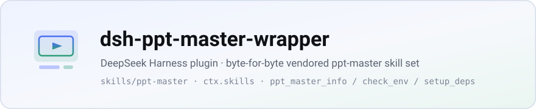
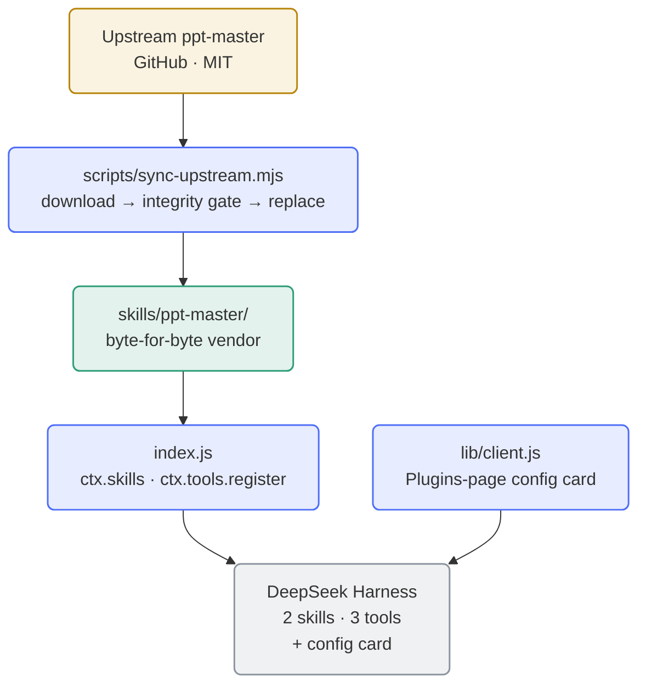

<div align="center">

**English** | [简体中文](README.md)

</div>

<div align="center">



</div>

# dsh-ppt-master-wrapper

**Faithfully wraps the upstream [ppt-master](https://github.com/hugohe3/ppt-master) skill set as a [DeepSeek Harness](https://github.com/deepseek-ai) (DSH) plugin** — byte-for-byte vendored, zero rewriting, zero runtime dependencies, one-command upstream sync.

The upstream skill set is a complete AI presentation workflow (generate / reconstruct / beautify PPTX, Brand·Style·Layout·Deck workspaces, native template filling). This wrapper rewrites none of it — it only **mounts it reliably into DSH**: registers the skills, exposes lifecycle tools, and adds venv interpreter isolation, a graphical configuration card and tool-visibility scoping.

- **Zero rewriting**: the vendored `skills/ppt-master/` is **byte-identical** to the upstream release, passing upstream's `attribution_guard.py` integrity gate by construction;
- **Zero runtime npm dependencies**: pure Node built-ins; the skill's Python dependencies are installed on demand by a lifecycle tool;
- **Updatable**: `scripts/sync-upstream.mjs` syncs a new upstream release in one command (download → integrity gate → verify → replace → commit/tag/push);
- **Isolatable interpreter**: optional venv mode gives upstream scripts a dedicated interpreter, landable on persistent volumes in containers;
- **Graphical configuration**: ships its own client half — a configuration card on DSH's Plugins page (bilingual), saving **takes effect without a restart**.

## Architecture



The skill surface is registered by `index.js` through `ctx.skills`: the vendored `ppt-master` skill plus an **in-memory, never-on-disk** entry skill `ppt-master-env` (interpreter routing entry). DSH injects the skill directory's absolute path via `resourceBase`, which the executing agent substitutes for upstream's `${SKILL_DIR}` convention — mechanically satisfying the hard rule in upstream's `SKILL.md`.

## Installation

### Prerequisites

| Dependency | Purpose | Notes |
|---|---|---|
| **DeepSeek Harness** | Host runtime | The plugin needs **DSH ≥ 0.2.2-rc.1** (`engines.dsh` plus a load-time `assertWhenCapable` gate). Older hosts refuse to load the **whole plugin** (all three tools and the vendored skill), because `when` would be ignored silently and scoping would stop working; stay on `v6.9.0-r2` if you must run 0.2.1 — the last release that does not require per-step `when` |
| **Node.js ≥ 22.12** | Plugin & tool runtime | Pure built-ins, no npm dependencies; 22.12 is the load-path floor (`require(esm)`) |
| **python3 ≥ 3.10** (`python` ≥ 3.10 also works on Windows) | Upstream scripts & integrity gate | `python3-venv` recommended (venv mode needs its ensurepip; POSIX layout only) |
| **pip3** (or `python -m pip` / `pip`) | Installing upstream Python deps | System mode resolves `pip3` → the resolved interpreter's `-m pip` → `pip`; venv mode uses `<venv>/bin/pip3` instead, unaffected by PEP 668 |
| **git** / **tar** | Sync script | Only needed when syncing upstream |

### Install into DSH

```bash
# Option 1: npm (recommended; same source as the plugin market)
dsh plugin --profile <name> add dsh-ppt-master-wrapper

# Option 2: install from GitHub
dsh plugin --profile <name> add https://github.com/SAXEM1997/dsh-ppt-master-wrapper.git

# Option 3: local path link (development machines)
dsh plugin --profile <name> add link:/path/to/dsh-ppt-master-wrapper
```

Option 4 — intranet mirror (optional, same source as GitHub): replace the URL with this repository's address on your intranet GitLab. Restart the session after installing and the `ppt-master` skill becomes visible to agents; the client half (config card) is loaded by the host **once after a restart** — afterwards saving configuration **takes effect without restarts**.

> **A note on npm versions**: wrapper revisions are named like `6.9.0-r1`, which semver treats as a **prerelease** (`6.9.0-r1 < 6.9.0`). The npm side always publishes the newest build under the `latest` tag, so `dsh plugin add dsh-ppt-master-wrapper` gets it; but a range such as `^6.9.0` will **not** include `6.9.0-r1` — pin the full version when you need a specific revision.

> **Back up your personal templates before upgrading.** Since upstream v6.10.0, templates created
> through Create Template live under `skills/ppt-master/templates/local/` (git-ignored upstream, so
> they are runtime data rather than release content). That path sits inside the plugin package, and
> `dsh plugin add` replaces the package wholesale on upgrade — copy that directory somewhere outside
> the package first. This repo's `sync-upstream.mjs` only protects it during **in-repo** syncs; it
> cannot stop a package manager from overwriting the plugin directory; a `prepack` guard
> (`scripts/check-pack.mjs`) additionally keeps user templates out of the published tarball.

### First run

1. **Environment check**: call `ppt_master_check_env` — confirms Python readiness (`python3`, or `python` on Windows), the integrity gate, and installed Python dependencies.
2. **Install Python dependencies**: call `ppt_master_setup_deps` (idempotent), or run `python -m pip install -r skills/ppt-master/requirements.txt` manually.
3. **Configure `.env` (as needed)**: upstream image-generation scripts need an image backend. In your **session working directory** (position 1 of upstream's `.env` lookup order; the package root is the position-3 fallback) run
   `cp skills/ppt-master/.env.example .env` and fill in `IMAGE_BACKEND` plus the provider key/model per the comments inside (process environment variables work too). `.env` is gitignored; plugin tools never read or echo its contents.

## Lifecycle tools

| Tool | Parameters | Behaviour |
|---|---|---|
| `ppt_master_info` | none | Plugin version, upstream version, absolute `SKILL_DIR`, upstream repo link. Read-only. |
| `ppt_master_check_env` | none | Environment check: Python readiness (`python3`, falling back to a qualifying `python` when missing or below 3.10, and naming the command that answered); runs `attribution_guard.py`; probes Python dependency state; hints whether `.env` exists. Read-only. |
| `ppt_master_setup_deps` | `user?`, `breakSystemPackages?` | Idempotent `requirements.txt` install (system mode resolves the installer), re-runs the check afterwards. **The only tool with side effects**; venv creation/removal happens only here. |

All three tools are **venv-aware** (payloads carry a `venv` section; with `venv.enabled=true` the tool descriptions gain an interpreter hint). `user` / `breakSystemPackages` are **effective in system mode only** — ignored in venv mode, noted in the response.

## Configuration

The plugin declares a native cordis Config — two key groups, every leaf `.volatile()`. Saving through the **Plugins-page card** takes the host's volatile fast path and **takes effect without a restart** (all three tools re-read the configuration on every call, `venv.*` exactly like `scope.*`; the one exception is the synthesized entry skill `ppt-master-env`, whose body is a registration-time snapshot and whose own footnote points at the two live tools); hand-editing the profile `cordis.patch.yml` **requires restarting DSH**. The two channels are equivalent — whichever writes first wins.

### The Plugins-page card (preferred entry)

GUI sidebar **Plugins → Installed → `dsh-ppt-master-wrapper`** → the card on the package detail page: three venv fields (`enabled` / `path` / `oldPathPolicy`), a "Tool visibility scope" section, and a version block — copy bilingual, following the interface language. In memory-mode sessions the card states explicitly that nothing will be written to the host configuration.

### venv isolation

| Key | Values | Default |
|---|---|---|
| `venv.enabled` | enable venv interpreter isolation | `false` |
| `venv.path` | venv directory (absolute or `~`-prefixed; relative paths are invalid) | `~/.ppt-master/venv` |
| `venv.oldPathPolicy` | what happens to the old venv after a path change: `keep` / `delete` | `keep` |

- **Lazy creation**: changing configuration has zero side effects; creation/removal happens only in `ppt_master_setup_deps`.
- **Platform**: venv isolation supports the POSIX layout only (`bin/python3`, `bin/pip3`); on Windows use system mode (the `python` fallback above applies).
- **Container advice**: point `venv.path` at a persistent volume (e.g. `/dsh-home/.ppt-master/venv`) — a venv's internal symlinks reference absolute container paths, so whether it survives an image change depends on the image staying the same.
- **Damage recovery**: delete and recreate (`rm -rf <venv.path>`, then re-run `setup_deps`); a half-built venv (missing `bin/pip3`) likewise — install `python3-venv` first if ensurepip is missing.
- **Deletion safety**: automatic deletion only touches old venvs that carry an **ownership marker** and satisfy the safety conditions; `enabled=false` deletes nothing; **do not store user data inside the venv directory**. Both kinds of orphan directories (unmarked / marked-but-unregistered) need manual `rm -rf`.
- **Configuration hot reload**: all three tools re-read `venv.*` on every call, so a card save applies immediately (no restart). The body of the synthesized entry skill `ppt-master-env` is a **registration-time snapshot** — after changing `venv.*` it still shows the old routing guidance; defer to `ppt_master_info` / `ppt_master_check_env`, which its footnote names (restarting DSH refreshes the body too).
- Full decision criteria and implementation details: [AGENTS.md](AGENTS.md) §6.

### Tool visibility scope (global / selected workspaces)

The three `ppt_master_*` tools are registered **globally** by default. If most of your workspaces have nothing to do with PPT, the scope keys remove them from those workspaces' tool tables **for real** — through the host's **per-step visibility** (`tools.register(def, { when })`), not a front-end filter: on every model step the host calls `tools.resolve()` and only tools whose condition holds enter that step's tool set.

| Key | Value | Default |
|---|---|---|
| `scope.mode` | `global` (every workspace) / `selected` (only the listed ones) | `global` |
| `scope.workspaceIds` | array of workspace id strings | `[]` |

Under `selected`: a session's ownership is resolved by "workspace `sessionIds` membership → canonical path of the session `cwd`"; visible only when resolved **and** listed — **sessions belonging to no workspace stay invisible**. Failure policy (an explicit narrowing intent is never silently widened): registry not ready or unreadable, no `cwd`, path miss, empty list, or judgement not finished yet ⇒ invisible for that step (fail-closed), with a single `console.warn` when the registry is not ready; saving the config takes effect on the next step.

Host floor: `scope` relies on per-step `when` (`tools.register(def, { when })` + `tools.resolve`), i.e. **DSH ≥ 0.2.2-rc.1**; older hosts lack it (0.2.1 silently ignores `when`), so this version declares the floor in `engines.dsh` and fails loud at load time instead of silently showing everything under `selected`.

Known limitations: only **tools** are narrowed, not the skill entry; judgement uses the session `cwd` (written by the host at creation and normally stable); a symlinked `cwd` may be invisible for the first step and visible from the next one after async canonicalisation; calling a hidden tool now fails with the host's `UNKNOWN_TOOL` (no custom denial message); ids of deleted workspaces are ignored; the marketplace screenshot `assets/screenshot-1-config-card.png` awaits regeneration (the card gained the scope section).

### Profile patch (the equivalent channel)

Edit the profile's `cordis.patch.yml` and append (**write every field** — a patch `config` replaces wholesale; **restart DSH afterwards**):

```yaml
- id: dsh-ppt-master-wrapper
  config:
    venv:
      enabled: true
      path: /dsh-home/.ppt-master/venv
      oldPathPolicy: keep
    scope:
      mode: selected
      workspaceIds:
        - b6ef89f7-74a6-4e4f-84eb-07581e390020
```

After a plugin upgrade adds new configuration fields, compare and complete existing patch entries (or simply re-save once on the card) — otherwise the new fields fall back to defaults.

## Restart boundaries and diagnostics

**What needs a restart**:

- Saving configuration on the card — **no** (volatile fast path; the tool side applies immediately, `venv.*` included). The **body** of the synthesized entry skill `ppt-master-env` is a registration-time snapshot and does not rewrite itself — its own footnote defers live state to `ppt_master_info` / `ppt_master_check_env`;
- Editing only `lib/client.js` — **no** (host hot-updates via stat polling, ~500 ms);
- Editing `package.json`'s `dsh.client` / `exports["./client"]` declarations, or the profile patch by hand — **yes**.

**Card missing / unavailable** — check in order: ① just edited the `package.json` declaration surface? restart DSH (most common); ② does the host Plugins page provide the `plugins.bundle.config` slot; ③ the card shows "configuration channel not connected" = host lacks the `configForms` service (optional wiring, everything else unaffected); ④ a host below 0.2.2-rc.1 refuses to load the **whole plugin** (not just the card) — upgrade the host; only a missing `dsh.client` declaration degrades to "no card, everything else works".

**Other**: a failed plugin load that takes the skill surface down with it is usually `@deepseek-ai/schemastery` resolution failure — an installed plugin resolves it by **bare import** from the profile's `node_modules` (the same path first-party plugins use), so first confirm the profile actually hoists the package; `DSH_NODE_MODULES` / `DSH_PROFILE_DIR` / `DSH_HOME` are only the fallback for `link:` development setups and are normally empty inside the host process (details in [AGENTS.md](AGENTS.md) §3). **Missing entry skill**: if the host rejects the synthetic candidate without `resourceBase`, only the entry skill is absent — the vendored skill and the tools are unaffected.

**Windows sandbox hosts: `--daemon` does not work for the preview servers (known upstream issue)**: such hosts place the command in a Job Object that forbids process breakaway (DSH included), so `confirm_ui` / `svg_editor` / `spec_review` print `pid=…`, then die together with the launching command (stale lock files remain, and `--wait-only` starts another server). The workaround is to run the foreground server inside a **host background task** (no `--daemon`, `--timeout 0` to keep it alive):

```bash
python <skill>/scripts/confirm_ui/server.py <project> --timeout 0
```

The page, `--wait-only` and `--shutdown` keep working as usual. Upstream tracking: [hugohe3/ppt-master#357](https://github.com/hugohe3/ppt-master/issues/357); the vendor tree is byte-identical, so this repository cannot patch it in place.

## Syncing a new upstream release

```bash
node scripts/sync-upstream.mjs [options]
```

| Option | Meaning |
|---|---|
| `--ref <tag\|branch\|commit>` | Upstream ref (default: latest semver release tag) |
| `--repo <url>` | Upstream repository URL (default `https://github.com/hugohe3/ppt-master.git`) |
| `--refresh` | Ignore the `.upstream/` cache and re-download |
| `--confirm-structural` | Structural changes confirmed by a human; force the automatic path |
| `--skip-guard` | Skip running `attribution_guard.py` (must combine with `--no-push` or `--dry-run`) |
| `--no-push` | Local commit + tag only, no push |
| `--dry-run` | Print what would happen |

Flow: resolve the latest tag → download (or reuse cache) → integrity gate → structural-change detection → automatic path: verification precedes replacement → replace `skills/` → bump the version (auto-rewriting the `lib/client.js` version constants) → commit + tag `v<version>` → push. **Structural changes 🔴** (skill dirs added/removed, renamed, `metadata.version` missing …) stop the run with a report (exit code 2, written to `sync-report.txt` at the repo root); assess manually and re-run with `--confirm-structural`.

**Push credentials**: set `DSH_PPT_GITLAB_PAT` (GitLab mirror) or configure a git credential helper; if missing, the push step fails with exit code 6 and prints guidance.

**Versioning**: `package.json` mirrors the upstream version (e.g. `6.7.1`); wrapper-only changes append an `-rN` suffix.

Exit codes: `0` ok/up-to-date · `1` usage · `2` structural change awaiting a human · `3` integrity gate · `4` verification · `5` network/source · `6` push/tag conflict · `7` missing toolchain.

## Repository layout

```
dsh-ppt-master-wrapper/
├── package.json / cordis.patch.yml   # DSH plugin manifest & bundle-layer patch
├── index.js                          # plugin entry
├── lib/                              # client half / tools / venv / skill provider / scope
├── skills/ppt-master/                # ★ upstream vendor tree (byte-for-byte)
├── scripts/                          # sync-upstream / verify-plugin / check-dsh-compat
├── tests/                            # full node:test suite (724 cases)
├── docs/superpowers/                 # design & plan documents (development history)
├── .github/                          # CI and issue/PR templates
└── README / AGENTS.md / CONTRIBUTING.md / NOTICE / LICENSE
```

## Development flow (GitHub Flow)

`main` is protected — **no direct pushes**. Every change goes **Issue → branch → PR → squash merge**; commit messages use conventional prefixes. Details in [CONTRIBUTING.md](CONTRIBUTING.md); agent-facing mechanism notes, the test map and version bookkeeping live in [AGENTS.md](AGENTS.md).

## Local verification (development)

```bash
node scripts/check-dsh-compat.mjs     # contract check: spec §7.7 six (+⑦) design-precondition probes
node --test tests/*.test.mjs          # full suite (724/724 with a real SDK on the machine; with `~/.ppt-master/.env` present, only the `envFileExists` case goes red)
node scripts/verify-plugin.mjs --upstream .upstream/refs/tags/<ref>@<sha>   # integrity check (needs the cache dir)
```

Machines without the host SDK (CI included): build the default stub tree with `node tests/helpers/stub-sdk.mjs .ci-stub`, then run the first two commands with `DSH_NODE_MODULES=$PWD/.ci-stub/node_modules` (expected: 724/722/2 skipped — skips are declared explicitly); mechanisms and red-light signatures in [AGENTS.md](AGENTS.md) §4, CI in `.github/workflows/ci.yml`.

## Version history

| Version (tag) | Notes |
|---|---|
| `v6.7.0` | Initial delivery: vendored upstream v6.7.0 + skill provider + three lifecycle tools + three scripts |
| `v6.7.0-r1` … `r2` | Wrapper revisions (review-fix waves: sync-script robustness) |
| `v6.7.0-r3` | venv interpreter isolation + Plugins-page config card + GitHub release surface |
| `v6.7.1` | Upstream sync: vendored v6.7.1 (byte-for-byte) |
| `v6.7.1-r1` | Tool visibility scope (two scope keys + assembly-layer removal + guard backstop) |
| `v6.7.1-r2` | Review-fix wave: scope runtime hardening (`safeString` / injection watchdog / disposed cleanup / single refresh per round) + card checkbox disabled-on-missing-baseline and read-only styling + stronger contract probes + single-pass strict resolution criterion |
| `v6.7.1-r3` | venv configuration is now **re-read live**: a card save applies to all three tools immediately instead of an apply-time snapshot (design R8 / issue #16); an invalid path warns at save time |
| `v6.7.3` | Upstream sync: vendored v6.7.3 (byte-for-byte). Carries the v6.7.2 "stop losing or overwriting content silently" batch (skill-only installs place projects in the working folder again, PDF tables no longer rewritten against one sample paper, HTML/`.txt` decoded by declared charset, same-titled batches no longer overwrite each other, whole-word image search, native-chart part-name collisions, formula MCE fallback so WPS/LibreOffice are not blank) and the v6.7.3 Edit Native round-trip fixes; also fixes `verify-plugin`'s `baseName` for backslash paths (no more false failure of check ⑥ on Windows) |
| `v6.8.0` | Upstream sync: vendored v6.8.0 (byte-for-byte). AI image generation now defaults to `gpt-image-2.5-sunburst` (~¼ the output tokens, ~½ the latency, real RGBA transparency), `aspect_ratio` accepts any positive W:H, and `Retry-After` is honored by every backend and by manifest requeues; Edit Native patches data-only chart edits in place (gradients, legends, per-point labels survive) and merged-cell tables no longer fail `--native-charts-and-tables`; PPTX import no longer hard-fails on zero-size geometry (unrecoverable geometry is kept and reported) and author-hidden content no longer leaks into source Markdown, the Beautify inventory, or rebuilt notes; `source_to_md` keeps Office Math as LaTeX, matches Word's DOCX text, and recovers skipped EPUB/ODT/RTF text; animation timing follows PowerPoint beat semantics; hyperlinks are compared after XML decoding; supported Python is capped at 3.14 |
| `v6.8.0-r1` | Wrapper revision (no runtime behaviour change): the `check-dsh-compat` guard probe now speaks DSH 0.2.2's executor contract — mount `@deepseek-ai/dsh-tool-executor-native`, then call the batched `tools.execute`; 0.2.1 and earlier keep the single-call shape, and both SDK generations pass. Also clears stale `schemaOf`-era doc coordinates and records both execution contracts in AGENTS §3. Vendored tree stays v6.8.0 byte-for-byte |
| `v6.8.0-r2` | Two scope runtime fixes (issue #33): (1) inject watchdog 5s → 30s — boot-time injection often lands after 5s, and the old value recorded a normal start as "judgement not in effect, tools visible everywhere" with no retraction; (2) liveness check before judging/installing a layer — `cannot create effect on inactive context` really means *the session was already disposed* (cordis `assertActive` only throws when `fiber.uid === null`), so short-lived child sessions (mnemon idle review) no longer spam `restrict installation rejected`; (3) one `scope 已激活（注入等待 Nms）：判定 N 个会话，隐藏 M 个` summary line. Default `global` still logs nothing |

| `v6.8.0-r3` | Load-time race fix (issue #36): `schemastery`'s CJS build `require()`s the ESM-only `cosmokit` on its first line, while the host loads plugins with parallel `import()`. When another plugin in the same batch is still loading cosmokit, that require throws `ERR_REQUIRE_ESM_RACE_CONDITION` and the whole plugin fails to activate. The entry now `await import()`s cosmokit before the `require`, resolving it from **schemastery itself** (so non-hoisted layouts do not silently degrade). The entry therefore carries a top-level `await`; a failed warm-up falls back to the previous path. Vendored tree stays byte-identical to v6.8.0 |

| `v6.8.0-r4` | Environment declaration and repository conventions: `engines.node` corrected from `>=20.0.0` to `>=22.12.0` (the load path needs `require(esm)`); the CI compatibility job becomes `node22-compat` pinned to that floor; release notes are now "formal summary + one line per PR + bilingual". No runtime behaviour change |
| `v6.9.0` | Upstream sync: vendored v6.9.0 (byte-for-byte). Image→PPTX gains OCR text evidence — `image_ocr.py scan` OCRs normalized page images into reviewable text blocks (line boxes, estimated font size, sampled ink), and the text layer becomes native text over a text-removed base, with `merge-base` re-reading the base and exiting 3 when text is left inside removal boxes; new `image_layers.py` (`check` verifies a layer is registered against the page, `diff-matte` derives a layer from the page's own pixels, `mono-matte` cuts a single-color graphic from a key plate) and `image_normalization.py`; the profile is no longer tied to one host, since any vision host with a reference-image path works (text removal defaults to `-b openai`, registered layers to `-b gemini`). `image_gen.py` adds `--gif-frames` for animated GIFs and the `gpt-image-2.6` family, and writes each image once in its filename's format (a `.jpg` keeps Gemini's JPEG bytes instead of a PNG round trip). Narration adds `--provider openai` (`gpt-realtime-2.1-mini` over the Realtime WebSocket, replacing `tts-1` and `gpt-4o-mini-tts`, which retire on 2027-01-06). Overwrite fixes: an export `-o` pointing at the source PPTX, and `source_to_md` outputs resolving or hardlinking to an input, are refused before anything is written; re-installing a template replaces its `Installed-from` line instead of stacking another. The dependency list is unchanged (19 entries, no venv rebuild), and the `__pycache__` that leaked into the v6.8.0 vendor tree is removed |
| `v6.9.0-r1` | npm channel and publish traceability. `package.json` gains `publishConfig` (pinning `registry.npmjs.org`, because the default registry here is a mirror and mirrors cannot publish); the bilingual READMEs promote npm to method one and note the semver trap (`6.9.0-r1` is a **prerelease**, `^6.9.0` does not include it, so pin the full version); the maintainer manual gains an npm release procedure. Publishing moves to `.github/workflows/publish.yml`, which runs `npm stage publish` in CI — this machine's egress is capped at ~23 KB/s and cannot upload the 17.7 MB tarball (three attempts all ended in ECONNRESET mid-transfer), while the runner's egress is fine — with the maintainer completing the release through `npm stage approve` under 2FA. That workflow now checks out `refs/tags/v<version>` from a required `version` input and asserts `package.json.version` matches: the previous version built from whatever `main` was at dispatch time, which is exactly why the published 6.9.0 and tag `v6.9.0` are not the same tree. It also enables `--provenance` (`id-token: write`), so npm signs an attestation binding the package to the commit and workflow. No runtime behaviour change |
| `v6.9.0-r2` | Load-time resolution back on the normal path (**runtime behaviour change**): inside the host process `DSH_HOME`, `DSH_PROFILE` and `DSH_PROFILE_DIR` are **always empty** — `dsh-shell-env` synthesizes them per shell call only, and `dsh-app-boot`'s `.env` layering rejects the `DSH_*` prefix as bootstrap-only. The previous build trusted those variables alone, so activation threw "all four location tiers missed" on a Desktop launch and on any plain-terminal `dsh` start, leaving the plugin disabled (that is the `1 entry did not activate` line). It now tries a plain `@deepseek-ai/schemastery` bare import first — a normally installed plugin is resolved by Node from the profile's `node_modules`, exactly like every official plugin — and falls back to the env chain, which now serves only the symlinked `link:` development checkout |
| `v6.9.0-r3` | Tool visibility now uses the host's **per-step `when`** (**runtime behaviour change; engine floor raised to DSH ≥ 0.2.2-rc.1**): the per-agent `tools.restrict` assembly layer, the root-`ctx` `tools.guard` fallback, the `agent/created` subscription, the injection watchdog and the re-check timer are all gone (about 2100 net lines removed); the three tools are registered with `tools.register(def, { when })` and the host `await`s each one per step inside `tools.resolve`. The predicate is synchronous and never throws; `global` never touches the registry; `selected` is fail-closed throughout. Two levels: `resolveNow` (session membership + string path) answers the current step synchronously, and a miss with a `cwd` schedules one async refinement (`judgeAgent` + `resolveByPath`, single-flight, 2 s throttle, generation token). Caches are keyed by the **agent object** (WeakMap), not its id: the positive entry binds `cwd`, the match basis (`member`/`path`) and a registry fingerprint, while the `no-match` negative entry is bound to the same fingerprint and only re-runs when the workspace list changes. **Behavioural differences**: calling a hidden tool now fails with the host's `UNKNOWN_TOOL` instead of a custom Chinese message; 0.2.1 and earlier refuse to load the **whole plugin** (both `engines.dsh` and a load-time `assertWhenCapable` gate), so users on 0.2.1 should stay on `v6.9.0-r1`. Tests 734 → 702 (the old mechanism's cases went with the code; when-semantics and cache-invalidation cases were added) |
| `v6.10.0` | Upstream sync (rule ①): vendor tree byte-identical to v6.10.0 (`refs/tags/v6.10.0@d8f704b…`); `lib/client.js` constants and `package.json.version` move to `6.10.0`, and wrapper revisions `v6.9.0-r1..r3` reset to zero. **Zero structural changes** (49 files, +2146 −344, no deletions, no directory add/remove); `requirements.txt` unchanged ⇒ no venv rebuild; `SKILL.md` only bumps `metadata.version`, so the entry-skill substitution rules still hold. **Adaptation**: upstream now keeps the personal template library at `skills/ppt-master/templates/local/<kind_dir>/` (git-ignored upstream, so it never appears in a release), which drove three wrapper changes: `sync-upstream.mjs` gained `installSkills()` to stash and restore that directory around the vendor swap (the previous wholesale delete would have destroyed user data); `verify-plugin`'s ⑥ check treats it as the single in-tree exemption (runtime data, not a vendor divergence); the root `.gitignore` ignores it. Tests 702 → **705**. The personal library lives inside the plugin package and is replaced on `dsh plugin add` upgrades, so back it up before upgrading |

> Versioning: the `base` mirrors upstream releases; wrapper revisions append `-rN`. Itemized details in [AGENTS.md](AGENTS.md) §5.

## Acknowledgements and licence

- Upstream project: [hugohe3/ppt-master](https://github.com/hugohe3/ppt-master) (MIT, © 2025-2026 Hugo He) — every capability of this wrapper comes from the upstream skill set; many thanks to the author.
- **Dual LICENSE attribution**: the root [`LICENSE`](LICENSE) is this project's own MIT licence; the vendored `skills/ppt-master/LICENSE` is the **upstream original, preserved byte-for-byte** (guarded by the integrity gate — do not modify). The full upstream copyright notice is in [`NOTICE`](NOTICE); the vendored `SPONSORS*.md` files are preserved likewise — consider sponsoring the original author.

MIT, see [LICENSE](LICENSE).
