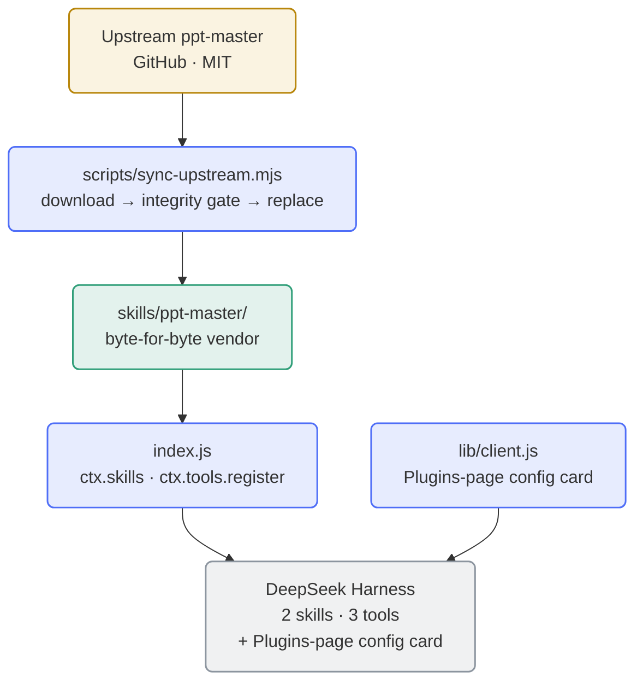

<div align="center">

**English** | [简体中文](README.md)

</div>

<div align="center">


</div>

# dsh-ppt-master-wrapper

**A faithful wrapper that packages the upstream [ppt-master](https://github.com/hugohe3/ppt-master) skill set as a [DeepSeek Harness](https://github.com/deepseek-ai) (DSH) plugin** — byte-for-byte vendoring, zero rewriting, zero runtime dependencies, one-command upstream sync.

The upstream skill set is a complete AI presentation workflow (generate / reconstruct / beautify PPTX, reusable Brand·Style·Layout·Deck workspaces, native template filling). This wrapper rewrites none of it; it only makes it **install cleanly into DSH**: it registers the skills, exposes lifecycle tools, and adds optional venv interpreter isolation plus a graphical configuration card.

- **Zero rewriting** — the vendored `skills/ppt-master/` is **byte-identical** to the upstream release and therefore passes the upstream `attribution_guard.py` integrity gate by construction;
- **Zero runtime npm dependencies** — implemented with Node built-ins only; the skill's Python dependencies are installed on demand by a lifecycle tool;
- **Updatable** — `scripts/sync-upstream.mjs` syncs a new upstream release in one command (download → integrity gate → verify → replace → commit/tag/push);
- **Isolated interpreter** — an optional venv mode gives the upstream scripts their own interpreter, which container users can place on a persistent volume;
- **Graphical configuration** — the package ships its own client half, so DSH's **Plugins** page renders a configuration card (bilingual) whose saves take effect **without a restart**.

## Architecture



The skill surface is registered by `index.js` through `ctx.skills`: the vendored `ppt-master` skill plus an **in-memory, never-written-to-disk** entry skill `ppt-master-env` (the interpreter routing entry). DSH injects the skill directory's absolute path via `resourceBase`, which the executing agent substitutes for the upstream `${SKILL_DIR}` convention — mechanically satisfying the hard rules in the upstream `SKILL.md`.

## Installation

### Prerequisites

| Dependency | Purpose | Notes |
|---|---|---|
| **DeepSeek Harness** | Host runtime | The client half (config card) needs **DSH ≥ 0.2.0-rc.2**; older hosts degrade quietly to "no card" and everything else keeps working |
| **Node.js ≥ 20** | Plugin and tool runtime | Built-ins only, no npm dependencies |
| **python3 ≥ 3.10** | Upstream script suite and integrity gate | `python3-venv` recommended (venv mode relies on its ensurepip; Alpine bundles it) |
| **pip3** | Installs upstream Python dependencies | In venv mode `<venv>/bin/pip3` is used instead and PEP 668 does not apply |
| **git** / **tar** | Sync script (ls-remote, commit, tag, push / tarball extraction) | Only needed when syncing upstream |

### Install into DSH

Option 1 — install straight from GitHub (recommended):

```bash
dsh plugin --profile <name> add https://github.com/SAXEM1997/dsh-ppt-master-wrapper.git
```

Option 2 — local path link (development machine / existing clone):

```bash
dsh plugin --profile <name> add link:/path/to/dsh-ppt-master-wrapper
```

Option 3 — internal mirror (optional, same source as GitHub): use this repository's URL on your self-hosted GitLab instead.

Restart the session after installing and the `ppt-master` skill becomes visible to the agent. The current package ships a **client half** (the Plugins-page config card), which the host loads for the first time only after **one host restart** — from then on, saving configuration takes effect **without a restart** (see "Restart boundaries and diagnostics").

### First run: environment check, dependencies and `.env`

1. **Environment check** — call the `ppt_master_check_env` tool to confirm python3 readiness, that the integrity gate passes, and that the Python dependencies are installed.
2. **Install Python dependencies** — call `ppt_master_setup_deps` (idempotently runs `pip3 install -r "${SKILL_DIR}/requirements.txt"`), or do it manually: `pip3 install -r skills/ppt-master/requirements.txt`.
3. **Configure `.env` (as needed)** — the upstream image-generation scripts need an image backend. Copy the vendored template into your **workspace root**:

   ```bash
   cp skills/ppt-master/.env.example .env
   ```

   > Run that `cp` in **your session working directory** (the cwd where you generate decks — the first location in the upstream `.env` lookup order). A copy at the plugin root is also read at the third position (`REPO_ROOT`; under the packaged layout the plugin root *is* the upstream `config.py` `REPO_ROOT`), but only when the working directory has no `.env`.

   Then fill in the image-backend API key: set `IMAGE_BACKEND` (the recommended core backends are `openai` / `gemini` / `qwen` / `zhipu` / `volcengine`) and uncomment the corresponding provider key/model lines. You may skip `.env` entirely and supply the same configuration through process environment variables. See the comments inside `.env.example` for every field and all available backends.

   > `.env` is listed in `.gitignore` and is never committed; the plugin's tools neither read nor echo `.env` contents or any secret.

## Lifecycle tools

The plugin registers three tools through `ctx.tools.register` (bilingual descriptions). The workflow itself (generating / reconstructing / beautifying decks) is skill-driven and is deliberately not wrapped as tools.

| Tool | Parameters | Behaviour |
|---|---|---|
| `ppt_master_info` | none | Returns the plugin version, the wrapped upstream version (parsed from the vendored `SKILL.md` `metadata.version`), the absolute `SKILL_DIR` (scans `skills/*/SKILL.md`, anchoring the main directory on `name: ppt-master`) and the upstream repo link. Read-only. |
| `ppt_master_check_env` | none | Environment check: python3 ≥ 3.10 readiness; runs the vendored `attribution_guard.py` and reports pass/fail; parses the top-level distribution names of `requirements.txt` and probes installation state through distribution metadata (`importlib.metadata`) as the primary means (entries without a dist→import mapping are reported UNKNOWN, not FAIL); checks whether `.env` exists (advisory only). Structured, read-only diagnostics. |
| `ppt_master_setup_deps` | `user?: boolean`, `breakSystemPackages?: boolean` | Idempotently runs `pip3 install -r "${SKILL_DIR}/requirements.txt"` (adding `--user` / `--break-system-packages` per the flags); re-runs the environment check afterwards and reports. **The only tool with side effects.** |

> All three tools are **venv-aware**: `ppt_master_info` / `ppt_master_check_env` payloads carry a `venv` section (`enabled` (**the configured value**) / `path` / `exists` / `pythonPath`, …); `ppt_master_setup_deps` carries `venv` and `cleanup` sections (where `enabled` is the **effective** state: `false` when configuration is off or invalid), and venv creation/removal happens only there. When `venv.enabled=true`, the `info` / `check_env` tool descriptions gain an interpreter hint (a fallback for models that skipped the entry skill).

## venv isolation and the configuration card

The plugin declares a native cordis Config (`venv.enabled` / `venv.path` / `venv.oldPathPolicy`, each leaf `.volatile()`). The package ships its own **client half** (`lib/client.js`, declared through `package.json`'s `dsh.client` / `exports["./client"]`), which renders this plugin's configuration card on the host's **Plugins** page — **the preferred configuration entry in this release**. On the host side, `dsh-settings.describe()` still projects a settings namespace for a volatile profile entry; the hand-written profile `cordis.patch.yml` entry remains an **equivalent channel** (next section) that does **not** hot-apply on manual edits and **requires restarting DSH**.

**Lazy creation**: the venv is created/removed **only** by `ppt_master_setup_deps`; changing configuration itself has zero side effects.

### The configuration card (preferred entry)

- **Where**: GUI sidebar **Plugins → Installed → `dsh-ppt-master-wrapper`** → the configuration card on the package detail page.
- **What**: three fields (`venv.enabled` switch / `venv.path` text box / `venv.oldPathPolicy` selector) plus a version block (plugin version / upstream ppt-master version / skill directory `<package root>/skills/ppt-master`), with copy that is **bilingual and follows the interface language**.
- **Save semantics**: changes go through the host configuration channel — all three leaves are volatile, so saves take the host's **volatile fast path** (writes only `fiber._config` + `_commitVolatile()` → `loader/volatile-update`, **without remounting or re-running `apply`**) and therefore take effect **without a restart** (tool behaviour and the entry skill text follow the swapped-in volatile references in place).
- **memory mode**: when the host provides configuration in memory mode (non-loopback browser), the card explicitly states that this session will not write to the host configuration — a write that never lands must not fail silently.
- **Failures**: save failures are presented in two classes (host rejection / overridden by a higher-priority configuration layer vs. transport failure); the "overridden" case is described only in general terms.
- **Equivalence**: the card and the profile patch channel are **equivalent — whichever writes first wins**.

## Tool visibility scope (global / selected workspaces)

This plugin registers its three `ppt_master_*` tools **globally** — by default every session sees them. If you keep many PPT-unrelated workspaces (`hermes` / `oa` / `llm` …), the two `scope` keys remove them from those workspaces' tool tables **for real** (the host's assembly-layer `tools.restrict`, not a front-end filter).

| Key | Values | Default |
|---|---|---|
| `scope.mode` | `global` (every workspace sees them) / `selected` (only the listed ones) | `global` |
| `scope.workspaceIds` | array of workspace id strings | `[]` |

**Resolution rules** (under `selected`): ① the workspace whose `sessionIds` contains the session wins; ② otherwise the session's `cwd` is matched by **canonical path** (`workspaceRegistry.resolveByPath`). Visible only when a workspace was resolved *and* its id is listed — everything else is hidden, including **sessions that belong to no workspace**.

**How to configure**: the plugin-page card's "Tool visibility scope" section — a mode radio plus a workspace checklist (the list comes from the host's `workspaces` service, no hand-typed ids). Saving takes effect immediately (volatile fast path + `loader/volatile-update`, **no restart**). When that service is unavailable the card shows the current selection read-only; edit `scope.workspaceIds` in the profile patch instead (that manual channel still needs a restart).

**Degradation**: `selected` is an explicit narrowing intent, so the host **never silently widens** it. Without `ctx.inject` / `agents` / `workspaceRegistry` the plugin denies its own tool calls under the strictest reading and logs one `console.warn`; a transient `registry.list()` failure **keeps the previous round's judgement** (one failed read never rewrites visibility). Without `tools.restrict` it degrades to "execution-layer denial only" (tools stay listed, calls are refused).

**Known limitations**:
- Only **tools** are narrowed; the `ppt-master` skill entry stays callable in every workspace (the host has no per-agent channel for skills).
- Judgement uses the session's `cwd` at creation time; switching the working directory mid-session does not re-judge.
- Ids of deleted workspaces are ignored (the card shows them as "no longer exists" and lets you uncheck them).
- If the host throws while a restriction layer is being released, that layer may stay in effect — restart DSH to clear it (one warning naming the agent is logged).
- The marketplace screenshot `assets/screenshot-1-config-card.png` has not been regenerated yet (the card gained this section); it will be refreshed in the next release.

### Configuration via profile patch (the equivalent channel)

Edit the profile's `cordis.patch.yml` and append:

```yaml
- id: dsh-ppt-master-wrapper
  config:
    venv:
      enabled: true
      path: /dsh-home/.ppt-master/venv
      oldPathPolicy: keep
    scope:
      mode: selected
      workspaceIds:
        - b6ef89f7-74a6-4e4f-84eb-07581e390020
```

**Write all three fields** — a patch `config` replaces wholesale (missing fields fall back to defaults) — and **restart DSH afterwards** (this **manual patch channel** has no hot-apply watcher, unlike the card's no-restart fast path).

`venv.path` must be absolute or start with `~` (`~` expands against the host process HOME; a relative path is invalid → venv is treated as off, plus an application-time `console.warn`; the visible feedback channels are the entry skill's "invalid configuration" state and `ppt_master_check_env`'s `venv.path=null`, which renders the literal line `venv: enabled=true path=- exists=false python=skipped`). Verify with `ppt_master_check_env`, which should print `venv: enabled=true path=<your path> …`.

> The `applies:"live"` printed by the host settings page's describe output is a fixed string; the **manual patch channel** does not hot-apply after edits, so do not infer "it applies live" from it — the card is the channel that needs no restart.

**Why the default path is `~/.ppt-master/venv`**: it suits non-container DSH users and matches the upstream `~/.ppt-master/.env` (`USER_ENV_FILE`) directory convention; container users should point it at a mounted volume (e.g. `/dsh-home/.ppt-master/venv`).

### Entry skill usage (four states)

Read `ppt-master-env` (in-memory, not on disk) **before any `ppt-master` routing**. Four states:

1. **venv on, created and ready** (ready = both the interpreter `<path>/bin/python3` and the install path `<path>/bin/pip3` work — the same criterion as `setup_deps`'s intake check) → always substitute the resolved absolute `<path>/bin/python3` for the literal `python3` in upstream scripts (including the `attribution_guard.py` call in step 2 of `SKILL.md`), and provide `SKILL_DIR`;
2. **venv on but not created** → call `ppt_master_setup_deps` first; do not run business scripts with the system `python3` before that;
3. **venv off** → the current system `python3`;
4. **invalid configuration** → apply the correction given in the skill text, then continue in system mode.

The **not-ready sub-state** (`on-ready` + `broken`: `bin/python3` unusable, **or** a half-built venv that has `bin/python3` but lacks `bin/pip3` — the residue of `python3 -m venv` failing at the ensurepip stage) is **not** state ①: there is no usable interpreter path to substitute, so the text gives state-② guidance ("prepare the environment with `setup_deps` first"), and `setup_deps` fails loudly with recovery instructions (delete the directory manually and re-run; when `bin/pip3` is missing it adds "install `python3-venv` if the system lacks ensurepip").

**All three surfaces agree**: for one and the same shape, `info` reports `exists=true ∧ pythonPath=null`, `check_env` renders `python=not found` (all deps UNKNOWN, guard `{skipped}`), and the entry text follows state ② — there is no split where one surface calls it healthy while another calls it not ready. The text is a **snapshot taken when the plugin instance was registered**: it can go stale after filesystem changes (e.g. a venv deleted externally); trust the live output of `ppt_master_info` / `ppt_master_check_env`.

### Deletion safety and orphan handling

- **A marker is the authorization**: automatic deletion only touches directories that carry the ownership marker (`<venv>/.ppt-master-wrapper.json`) **and** satisfy all four conditions (path ≠ current; old and new paths are not **segment-aware** prefix-containers of each other; `pyvenv.cfg` exists; marker present). Conditions ① and ② are decided on **canonical** paths — repeated separators, `.`/`..`, symlink aliases, and `..` spelled over a symlink all normalize to the same shape using **kernel semantics**, so both **identity** (canonical equality; `dev+ino` equality as an extra positive criterion) and **containment** are rejected on that basis: the venv in use, its ancestors and its inner directories can never land on the deletion path. Prefix containment is **segment-aware**: `/a/venv` does not contain `/a/venv-older` (a naive `startsWith` rejects it and the old venv could never be cleaned up). The deletion primitive still receives the **original** configured path.
  **Degenerate filesystems**: alias detection relies on `realpath`/`st_ino`; on filesystems where `st_ino`/`st_dev` are 0 the `dev+ino` criterion is disabled automatically (otherwise any two directories would compare "equal" and cleanup would deadlock), leaving canonical-path comparison — such filesystems may **reject more often** (strictly the conservative direction). **Limitation**: "never deletes the wrong thing" holds only for aliases `realpath` can resolve; if a canonical-unresolvable alias exists (e.g. a bind mount), that protection does not cover the containment face. **User data placed inside a marked venv directory is deleted recursively** — do not store data there.
- **Manual cleanup after disabling**: `venv.enabled=false` **deletes nothing**; with `oldPathPolicy=keep` (the default) the old venv is kept for manual cleanup, and even `delete` only removes an ownership-marked old directory that satisfies the four conditions. Manual cleanup: `rm -rf <old venv.path>`.
- **Two kinds of orphans (both handled manually)**:
  1. **Unmarked orphan** (a venv directory without the marker): cleanup never touches it (the safe default) and `info` / `check_env` do not mention it — remove it manually with `rm -rf`.
  2. **Marked but unregistered orphan**: the registry lives at `<HOME>/.ppt-master/wrapper-state.json` while the venv usually lives on a persistent volume — a **layer mismatch**: in containers HOME is volatile, so after a container rebuild the registry is gone and the old venv becomes "marked but unregistered"; with no registry entry there is no basis for cleanup, so it is **never deleted automatically** and must be removed manually.

### Mounted volumes, image invariance and PEP 668

- **Mounted volumes**: a mount only guarantees that **data survives**; after a container rebuild, whether the venv still works depends on the **image staying the same** (symlinks inside a venv point at absolute paths in the container). **Recommendation**: configure `venv.path` onto a persistent volume (e.g. `/dsh-home/.ppt-master/venv`) instead of the container rootfs.
- **Recovery from damage**: after an image change, or when the venv is damaged (the not-ready sub-state), the recovery is **delete and recreate**: `rm -rf <venv.path>` then re-run `ppt_master_setup_deps` (the tool never deletes a damaged venv by itself, it only prints that guidance). A **half-built venv** (`bin/python3` without `bin/pip3`) is likewise delete-and-recreate; if the root cause is a missing ensurepip, install `python3-venv` first, otherwise recreating fails the same way.
- **PEP 668**: on hosts whose system Python is PEP 668 (EXTERNALLY-MANAGED), a bare `pip3 install` needs `--break-system-packages`, lands in the container rootfs and is lost on rebuild. With venv isolation enabled, installation goes through `<venv>/bin/pip3 install -r ...`, which PEP 668 does not block. The `user` / `breakSystemPackages` parameters are **effective in system mode only**; in venv mode they are ignored and the response says so.

## Restart boundaries and diagnostics

### Restart boundaries

- **Saving configuration needs no restart**: all three leaves are volatile, so saves take the host's volatile fast path (**no remount, no re-running `apply`**).
- **Only the declaration surface needs a restart**: changing `dsh.client` or `exports["./client"]` (`package.json`) requires a host restart to reload the client half; editing `lib/client.js` alone needs **no restart** (the host hot-updates it through stat polling, ~500 ms).
- **Manually editing profile `cordis.patch.yml` is a different channel**: it does **not** take the volatile fast path and has no hot-apply watcher, so it **requires restarting DSH**.

### Config card diagnostics (layered checks when the card is missing or unavailable)

This package ships its own client half (it registers a `plugins.bundle.config` card, keyed by package name), so **this DSH version should show the configuration card**. If the card is missing or reports itself unavailable, check these four layers in order:

1. **Is the declaration surface in effect?** `dsh.client` / `exports["./client"]` are **load-time** declarations — a just-edited `package.json` needs a **DSH restart** to reload the client half (editing `lib/client.js` alone needs no restart; stat polling hot-updates it). This is the most common "I changed it and nothing happened".
2. **Is the host page present?** The card is rendered by the Plugins page under the slot name `plugins.bundle.config`; if the host page `dsh-client-ui-plugin-manager` is absent or does not provide that slot, **nobody declares the slot, so no card appears** (different from "the half is not loaded"; also note the host **silently skips** packages named in `dsh.client.inject` that are absent from its graph, without warning — `inject` orders loading, it is not cordis service injection).
3. **Is the `configForms` service available?** It is attached **optionally** through `ctx.inject(['configForms'], cb)` (**not** in the hard `inject` list). A missing service means the callback never fires and that attachment is not registered, while the slot registration still happens — the card then shows "**configuration channel not connected**: the host provides no `configForms` service" (the snapshot stays `undefined`; when the namespace is not exposed a separate "channel **unavailable**" state is shown, and the two messages are never mixed).
4. **Old hosts that ignore `dsh.client`**: the field is **inert metadata** — the host half keeps working and the browser loads nothing, so it **degrades quietly with no loss of plugin functionality** (there is simply no card). Configuration can still go through the profile patch channel, or upgrade the host. **Host floor**: the client half depends on DSH 0.2.0-rc.2 contracts (`dsh.engines.dsh` still says `>=0.1.1-rc.1`, so old hosts are not refused at the engine gate — they take this quiet-degradation path instead).

**There are also hard-failure shapes (not quiet degradation)**: when the hard services `slots` / `locale` are missing, `apply` **is not called** and the host reports `pending (waiting for service…)`; likewise, if `dsh.client.external` does not declare `react`, `require` cannot reach the module table and **bubbles out of the page**. An exception in a single registration point (dictionaries / slot / subscription) is caught → warn per point and does **not** affect the others.

### Other diagnostics

- **schemastery resolution failure**: at load time the plugin fetches `@deepseek-ai/schemastery` through "locate the host node_modules + `createRequire` controlled resolution" (**no bare ESM import allowed**); failure is load-time fail-loud — **the whole plugin cannot load and the vendored skill surface goes with it**. Diagnose by confirming the package exists in the host profile's `node_modules` and that `DSH_NODE_MODULES` / `DSH_PROFILE_DIR` / `DSH_HOME(+DSH_PROFILE)` point at it.
- **Missing entry skill**: if the host's registration surface rejects the synthetic candidate **without `resourceBase`**, the entry skill is missing while the **vendored skill is unaffected** (the entry is not on disk and not part of the byte-comparison surface); the field is proven by host sources to be an optional pass-through field, and the compat script's §7.7⑤ actually exercises its acceptance.
- **Wording for the invalid-configuration row**: with `enabled=true` plus an invalid path, tool descriptions still show the venv hint according to the **configuration switch** while actual behaviour degrades to system mode — trust `venv.path=null` (rendering `venv: enabled=true path=- exists=false python=skipped`) and state ④ of the entry skill.

### Profile entry and upgrade completion

- **bundle insert layer**: the package ships `cordis.patch.yml` (an `insert:` entry `id: dsh-ppt-master-wrapper`) that takes effect with the installation — statically asserted by `check-dsh-compat`.
- **profile layer entry**: may be created **by the operator** (the YAML above; the bundle layer's `insert:` only declares the entry id, it carries no config). If the host has no such id, then the first time any venv field is edited and saved through the **Plugins-page card** (or the host config-editor channel) the host creates a same-shaped entry (`index<0` → `add({id,name,config})`) — the two channels are equivalent, first writer wins. A statically present bundle layer does **not** replace a profile-layer entry.
- **Upgrade completion (wholesale replace semantics)**: a patch `config` replaces wholesale, it is not deep-merged — after the plugin adds fields, an existing patch entry must be compared and completed against the new field set, otherwise new fields fall back to defaults (an old entry does not grow `enabled` by itself). After upgrading, save once on the **Plugins-page card** or **compare and complete by hand**.

## Syncing a new upstream release

```bash
node scripts/sync-upstream.mjs [options]
```

| Option | Meaning |
|---|---|
| `--ref <tag\|branch\|commit>` | Upstream ref to sync (default: the newest semantic-version release tag) |
| `--repo <url>` | Upstream repository URL (default `https://github.com/hugohe3/ppt-master.git`; `ls-remote` and the tarball download use the same value) |
| `--refresh` | Ignore the `.upstream/` cache and download again |
| `--confirm-structural` | Structural change already reviewed by a human: force the automatic path (re-runs the previously detected ref) |
| `--skip-guard` | Skip running `attribution_guard.py` (must be combined with `--no-push` or `--dry-run`; the JS-equivalent verify-plugin check still blocks, so this is not an integrity pass) |
| `--no-push` | Local commit + tag only, no push |
| `--dry-run` | Print what would change; no replace/commit/tag/push |

Flow: resolve the newest release tag → download (or reuse the `.upstream/` cache) → staging → integrity gate (run the guard per skill) → structural-change detection → when there is no structural change (or it is confirmed), the automatic path runs: verify-plugin before replacement → replace `skills/` with staging → bump the `package.json` version → a single commit + tag `v<version>` → push.

A **structural change 🔴** (skill directory added/removed, skill renamed, missing `metadata.version`, …) stops the run with a report (exit code 2, written to `sync-report.txt` at the repo root): review it by hand, update the wrapper as needed, then re-run with `--confirm-structural`.

**Push credentials**: set the `DSH_PPT_GITLAB_PAT` environment variable (self-hosted GitLab mirror) or use a `git` credential helper; when absent, the push step fails with exit code `6` and prints configuration guidance in the report.

**Version policy**: the `package.json` version mirrors the upstream version (e.g. `6.7.1`); wrapper-only changes or re-syncing the same version append an `-rN` suffix.

Exit codes: `0` success / already up to date; `1` usage error; `2` structural change awaiting a human; `3` integrity gate failed; `4` verify-plugin failed (the vendored tree was not touched); `5` network/source failure; `6` push failure / tag conflict; `7` missing toolchain (python3/git/tar unavailable, or the guard script cannot run).

## Repository layout

```
dsh-ppt-master-wrapper/
├── package.json                  # DSH plugin manifest (dsh.client / dsh.bundle.patch / exports)
├── cordis.patch.yml              # DSH bundle-layer patch (the insert entry)
├── index.js                      # Plugin entry: ctx.skills registration + ctx.tools.register × 3
├── lib/
│   ├── client.js                 # Client half: the Plugins-page config card (self-contained file)
│   ├── tools.js                  # The three lifecycle tools
│   ├── venv.js                   # venv resolution / readiness / safe deletion
│   └── skill-provider.js         # Vendored skill surface + synthetic ppt-master-env entry
├── skills/ppt-master/            # ★ Upstream vendor tree (byte-for-byte, zero rewriting)
├── scripts/
│   ├── sync-upstream.mjs         # Upstream sync (download/gate/replace/commit/tag/push)
│   ├── verify-plugin.mjs         # Integrity + provider/tool-surface checks
│   └── check-dsh-compat.mjs      # Contract checks against the installed DSH SDK
├── tests/                        # The node:test suite (570+ cases)
├── static/logo.svg               # Header image
├── docs/superpowers/             # This project's designs and plans (development history)
├── README.md / README.en.md
├── NOTICE
└── LICENSE
```

## Development workflow (GitHub Flow)

`main` is protected and never pushed to directly. Every change goes **Issue → branch → PR → squash merge**: open an issue stating the motivation and acceptance criteria, branch off `main` as `feat/…`, `fix/…`, `chore/…` or `docs/…`, run the three verification commands below and paste the results into the PR, then squash-merge and delete the branch. Commit messages use conventional prefixes (`feat:`, `fix:`, `docs:`, `chore:`, …).

See [CONTRIBUTING.md](CONTRIBUTING.md) for the details, the red lines and the version policy; issue and PR templates ship with the repository.

## Local verification (development)

```bash
# Integrity + provider/tool-surface checks (--root defaults to the packaged skills/;
# --upstream is required and takes the .upstream/ cache directory name <ref>@<sha>)
node scripts/verify-plugin.mjs --upstream .upstream/refs/tags/v6.7.1@aabf2a0541d9d3b0bdb9e8564a0217f0eaff7815

# Contract checks against the installed DSH SDK (real SkillRegistry mount + tools.register
# + rank + the §7.7 six-item design-feasibility pre-checks: Config volatile / apply second
#   argument / bundle insert layer / schemastery controlled resolution channel / reading the
#   entry skill back in production-root shape / client-half stub loading and registration)
node scripts/check-dsh-compat.mjs

# The whole suite
node --test tests/*.test.mjs
```

> **Environment prerequisite (the schemastery controlled-resolution channel)**: `tests/apply.test.mjs`,
> `tests/verify-plugin.test.mjs` and `scripts/verify-plugin.mjs` all **statically import `../index.js`**, and the
> entry fetches `@deepseek-ai/schemastery` at **module-load time**. On a clean machine where that package cannot be
> resolved, those three files **fail as a whole at import time** (not one case at a time) — make it resolvable via
> `DSH_NODE_MODULES` / `DSH_PROFILE_DIR` / `DSH_HOME`(+`DSH_PROFILE`) or the host profile's `node_modules`
> (see "schemastery resolution failure" above).
>
> **The same prerequisite also covers `tests/compat.test.mjs`, by a different mechanism and with a different red
> signature (measured)**: that file does not statically import the plugin entry, but 13 in-process
> `runCompatCheck({ … env: {} })` calls use the script's **real** dynamic `import(PLUGIN_ENTRY)` (the compat script
> deliberately does not go through the injectable `importModule` channel), and `options.env` only feeds SDK
> location, it cannot seal the plugin side's reads of `process.env`. The file therefore depends on the host
> `@deepseek-ai/schemastery` being resolvable (a real in-process load): **in a clean environment 7 of its 36 cases
> are red and 29 green** (7 of the 13 in-process ones), **not** a wholesale red. The identifiable red signature is
> the `schemastery 定位失败` string; the other 29 cases (including every CLI subprocess case, which injects a stub
> tree via `DSH_NODE_MODULES=<stub tree>/node_modules` and its own `{env:{}}` failure grouping) stay green.
>
> **Machines without the host SDK (including GitHub Actions CI, issue #4)**: no DSH runtime needed — the repo
> ships a stub SDK builder (`tests/helpers/stub-sdk.mjs`, the exact implementation `tests/compat.test.mjs` uses to
> build its stub trees). Two commands run the full suite on a clean machine:
>
> ```bash
> node tests/helpers/stub-sdk.mjs .ci-stub      # build the default-shaped stub node_modules
> DSH_NODE_MODULES=$PWD/.ci-stub/node_modules node --test tests/*.test.mjs
> DSH_NODE_MODULES=$PWD/.ci-stub/node_modules node scripts/check-dsh-compat.mjs
> ```
>
> Expected baseline: **688 tests / 686 pass / 0 fail / 2 skipped** (both skips are declared explicitly:
> `@deepseek-ai/dsh-tools` is unreachable via package-self resolution — this package has zero npm dependencies,
> so a skip is not a failure). The CI workflow lives at `.github/workflows/ci.yml` (runs on pushes to `main` and
> all PRs; `verify-plugin` is not run in CI because its item ⑥ needs a real upstream comparison tree — that
> logic is covered by fixture-based cases).

## Version history

| Version (tag) | Notes |
|---|---|
| `v6.7.0` | First delivery: vendored upstream v6.7.0 (78 MB, byte-for-byte) + the skill provider + three lifecycle tools + the verify/compat/sync scripts |
| `v6.7.0-r1` | Wrapper revision (the first automatic rule-③ bump): Gate 3 review fixes — `mapDistToImport` prototype-key hardening, branch-ref last-sync readability, three `envFileExists` probes, spec §4.3 rule-③ actor revision (automatic semantics) |
| `v6.7.0-r2` | Wrapper revision (rule ③): two rounds of independent UltraReview fixes — rule-③ self-trigger anchoring exclusion, tag re-push after partial push failure (auth pre-check), branch sha caching, git/tar toolchain absence mapped to exit 7, marketplace version-check layer correction, the 4th `env` probe location (`~/.ppt-master/.env`), dependency mapping 19/19, an independent `${SKILL_DIR}` criterion, `.gitignore` hygiene entries, dry-run state-write gating, four documentation corrections |
| `v6.7.0-r3` | Wrapper revision: **venv interpreter isolation** (`venv.enabled` / `venv.path` / `venv.oldPathPolicy` + the `ppt-master-env` entry skill + four-condition safe deletion) and the **Plugins-page configuration card** (client half: bilingual, version block, volatile fast-path saves without restart), plus the card's visual alignment with the host design vocabulary; this release also completes the GitHub publishing surface (bilingual README / NOTICE / logo / package metadata) |
| `v6.7.1-r1` | Tool visibility scope (global / selected workspaces): `scope.mode` + `scope.workspaceIds`, a workspace checklist on the plugin-page card; host side removes the tools per agent via `tools.restrict` with a global `tools.guard` backstop; upstream 6.7.1 unchanged (wrapper-only revision) |
| `v6.7.1` | Upstream sync (rule ①: the upstream version changed ⇒ base 6.7.1, the `-r` suffix resets to zero): vendored upstream v6.7.1 byte-for-byte, integrity gate passed; the previous three wrapper revisions (r1–r3) applied to the 6.7.0 base |

> Version rule: the `base` mirrors the upstream release; wrapper revisions append `-rN` (no suffix means r0).

## Credits and license

- Upstream project: [hugohe3/ppt-master](https://github.com/hugohe3/ppt-master) (MIT, © 2025-2026 Hugo He) — every capability of this wrapper comes from the upstream skill set; thanks to its author for excellent work.
- **Dual LICENSE attribution**: the plugin root [`LICENSE`](LICENSE) is this project's own MIT license for `dsh-ppt-master-wrapper`; the vendored `skills/ppt-master/LICENSE` is the **upstream original, preserved byte-for-byte** (enforced by the upstream `attribution_guard.py` integrity gate and not to be modified). The two coexist independently; see [`NOTICE`](NOTICE) for the full upstream attribution.
- Attribution files inside the vendored tree such as `SPONSORS.md` / `SPONSORS_CN.md` are likewise preserved byte-for-byte — please consider sponsoring the original author as the upstream guide suggests.

MIT, see [LICENSE](LICENSE).
