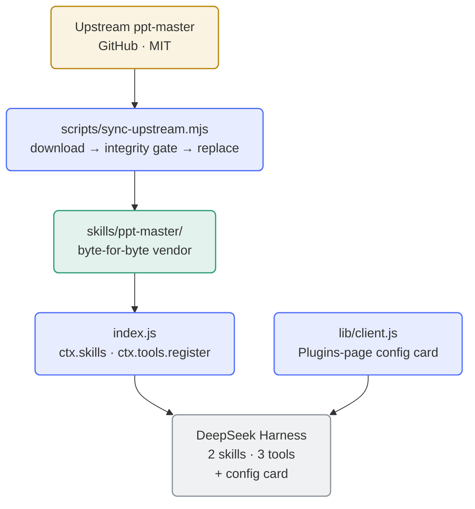

<div align="center">

**English** | [简体中文](README.md)

</div>

<div align="center">


</div>

# dsh-ppt-master-wrapper

**Faithfully wraps the upstream [ppt-master](https://github.com/hugohe3/ppt-master) skill set as a [DeepSeek Harness](https://github.com/deepseek-ai) (DSH) plugin** — byte-for-byte vendored, zero rewriting, zero runtime dependencies, one-command upstream sync.

The upstream skill set is a complete AI presentation workflow (generate / reconstruct / beautify PPTX, Brand·Style·Layout·Deck workspaces, native template filling). This wrapper rewrites none of it — it only **mounts it reliably into DSH**: registers the skills, exposes lifecycle tools, and adds venv interpreter isolation, a graphical configuration card and tool-visibility scoping.

- **Zero rewriting**: the vendored `skills/ppt-master/` is **byte-identical** to the upstream release, passing upstream's `attribution_guard.py` integrity gate by construction;
- **Zero runtime npm dependencies**: pure Node built-ins; the skill's Python dependencies are installed on demand by a lifecycle tool;
- **Updatable**: `scripts/sync-upstream.mjs` syncs a new upstream release in one command (download → integrity gate → verify → replace → commit/tag/push);
- **Isolatable interpreter**: optional venv mode gives upstream scripts a dedicated interpreter, landable on persistent volumes in containers;
- **Graphical configuration**: ships its own client half — a configuration card on DSH's Plugins page (bilingual), saving **takes effect without a restart**.

## Architecture



The skill surface is registered by `index.js` through `ctx.skills`: the vendored `ppt-master` skill plus an **in-memory, never-on-disk** entry skill `ppt-master-env` (interpreter routing entry). DSH injects the skill directory's absolute path via `resourceBase`, which the executing agent substitutes for upstream's `${SKILL_DIR}` convention — mechanically satisfying the hard rule in upstream's `SKILL.md`.

## Installation

### Prerequisites

| Dependency | Purpose | Notes |
|---|---|---|
| **DeepSeek Harness** | Host runtime | The config card needs **DSH ≥ 0.2.0-rc.2**; older hosts degrade quietly to "no card" with no other impact |
| **Node.js ≥ 20** | Plugin & tool runtime | Pure built-ins, no npm dependencies |
| **python3 ≥ 3.10** | Upstream scripts & integrity gate | `python3-venv` recommended (venv mode needs its ensurepip) |
| **pip3** | Installing upstream Python deps | venv mode uses `<venv>/bin/pip3` instead, unaffected by PEP 668 |
| **git** / **tar** | Sync script | Only needed when syncing upstream |

### Install into DSH

```bash
# Option 1: install from GitHub (recommended)
dsh plugin --profile <name> add https://github.com/SAXEM1997/dsh-ppt-master-wrapper.git

# Option 2: local path link (development machines)
dsh plugin --profile <name> add link:/path/to/dsh-ppt-master-wrapper
```

Option 3 — intranet mirror (optional, same source as GitHub): replace the URL with this repository's address on your intranet GitLab. Restart the session after installing and the `ppt-master` skill becomes visible to agents; the client half (config card) is loaded by the host **once after a restart** — afterwards saving configuration **takes effect without restarts**.

### First run

1. **Environment check**: call `ppt_master_check_env` — confirms python3 readiness, the integrity gate, and installed Python dependencies.
2. **Install Python dependencies**: call `ppt_master_setup_deps` (idempotent), or run `pip3 install -r skills/ppt-master/requirements.txt` manually.
3. **Configure `.env` (as needed)**: upstream image-generation scripts need an image backend. In your **session working directory** (position 1 of upstream's `.env` lookup order; the package root is the position-3 fallback) run
   `cp skills/ppt-master/.env.example .env` and fill in `IMAGE_BACKEND` plus the provider key/model per the comments inside (process environment variables work too). `.env` is gitignored; plugin tools never read or echo its contents.

## Lifecycle tools

| Tool | Parameters | Behaviour |
|---|---|---|
| `ppt_master_info` | none | Plugin version, upstream version, absolute `SKILL_DIR`, upstream repo link. Read-only. |
| `ppt_master_check_env` | none | Environment check: python3 readiness; runs `attribution_guard.py`; probes Python dependency state; hints whether `.env` exists. Read-only. |
| `ppt_master_setup_deps` | `user?`, `breakSystemPackages?` | Idempotent `requirements.txt` install, re-runs the check afterwards. **The only tool with side effects**; venv creation/removal happens only here. |

All three tools are **venv-aware** (payloads carry a `venv` section; with `venv.enabled=true` the tool descriptions gain an interpreter hint). `user` / `breakSystemPackages` are **effective in system mode only** — ignored in venv mode, noted in the response.

## Configuration

The plugin declares a native cordis Config — two key groups, every leaf `.volatile()`. Saving through the **Plugins-page card** takes the host's volatile fast path and **takes effect without a restart** (all three tools re-read the configuration on every call, `venv.*` exactly like `scope.*`; the one exception is the synthesized entry skill `ppt-master-env`, whose body is a registration-time snapshot and whose own footnote points at the two live tools); hand-editing the profile `cordis.patch.yml` **requires restarting DSH**. The two channels are equivalent — whichever writes first wins.

### The Plugins-page card (preferred entry)

GUI sidebar **Plugins → Installed → `dsh-ppt-master-wrapper`** → the card on the package detail page: three venv fields (`enabled` / `path` / `oldPathPolicy`), a "Tool visibility scope" section, and a version block — copy bilingual, following the interface language. In memory-mode sessions the card states explicitly that nothing will be written to the host configuration.

### venv isolation

| Key | Values | Default |
|---|---|---|
| `venv.enabled` | enable venv interpreter isolation | `false` |
| `venv.path` | venv directory (absolute or `~`-prefixed; relative paths are invalid) | `~/.ppt-master/venv` |
| `venv.oldPathPolicy` | what happens to the old venv after a path change: `keep` / `delete` | `keep` |

- **Lazy creation**: changing configuration has zero side effects; creation/removal happens only in `ppt_master_setup_deps`.
- **Container advice**: point `venv.path` at a persistent volume (e.g. `/dsh-home/.ppt-master/venv`) — a venv's internal symlinks reference absolute container paths, so whether it survives an image change depends on the image staying the same.
- **Damage recovery**: delete and recreate (`rm -rf <venv.path>`, then re-run `setup_deps`); a half-built venv (missing `bin/pip3`) likewise — install `python3-venv` first if ensurepip is missing.
- **Deletion safety**: automatic deletion only touches old venvs that carry an **ownership marker** and satisfy the safety conditions; `enabled=false` deletes nothing; **do not store user data inside the venv directory**. Both kinds of orphan directories (unmarked / marked-but-unregistered) need manual `rm -rf`.
- **Configuration hot reload**: all three tools re-read `venv.*` on every call, so a card save applies immediately (no restart). The body of the synthesized entry skill `ppt-master-env` is a **registration-time snapshot** — after changing `venv.*` it still shows the old routing guidance; defer to `ppt_master_info` / `ppt_master_check_env`, which its footnote names (restarting DSH refreshes the body too).
- Full decision criteria and implementation details: [AGENTS.md](AGENTS.md) §6.

### Tool visibility scope (global / selected workspaces)

The three `ppt_master_*` tools are registered **globally** by default. If most of your workspaces have nothing to do with PPT, the scope keys remove them from those workspaces' tool tables **for real** (the host's assembly-layer `tools.restrict`, not a front-end filter):

| Key | Values | Default |
|---|---|---|
| `scope.mode` | `global` (every workspace) / `selected` (only the listed ones) | `global` |
| `scope.workspaceIds` | array of workspace id strings | `[]` |

Under `selected`: a session's ownership is resolved by "workspace `sessionIds` membership → canonical path of the session `cwd`"; visible only when resolved **and** listed — **sessions belonging to no workspace stay invisible**. Degradation (an explicit narrowing intent is never silently widened): missing judgement services → deny under the strictest reading plus one `console.warn`; a transient registry read failure keeps the previous round's judgement; a host without `tools.restrict` degrades to execution-layer denial only. Configure via the card's mode radio + workspace checklist (fed by the host `workspaces` service); saving takes effect immediately.

Host floor: besides the config card, `scope.mode=selected` also depends on the host injecting the `agents` / `workspaceRegistry` services and the `tools.restrict` / `tools.guard` capabilities; when any is missing the scope falls back or denies under the readings above (never silently widened), with no impact on `global` mode or the rest of the plugin.

Known limitations: only **tools** are narrowed, not the skill entry; judgement uses the `cwd` at session creation; ids of deleted workspaces are ignored; a restriction layer may linger if the host throws during release (a restart clears it); the marketplace screenshot `assets/screenshot-1-config-card.png` awaits regeneration (the card gained the scope section).

### Profile patch (the equivalent channel)

Edit the profile's `cordis.patch.yml` and append (**write every field** — a patch `config` replaces wholesale; **restart DSH afterwards**):

```yaml
- id: dsh-ppt-master-wrapper
  config:
    venv:
      enabled: true
      path: /dsh-home/.ppt-master/venv
      oldPathPolicy: keep
    scope:
      mode: selected
      workspaceIds:
        - b6ef89f7-74a6-4e4f-84eb-07581e390020
```

After a plugin upgrade adds new configuration fields, compare and complete existing patch entries (or simply re-save once on the card) — otherwise the new fields fall back to defaults.

## Restart boundaries and diagnostics

**What needs a restart**:

- Saving configuration on the card — **no** (volatile fast path; the tool side applies immediately, `venv.*` included). The **body** of the synthesized entry skill `ppt-master-env` is a registration-time snapshot and does not rewrite itself — its own footnote defers live state to `ppt_master_info` / `ppt_master_check_env`;
- Editing only `lib/client.js` — **no** (host hot-updates via stat polling, ~500 ms);
- Editing `package.json`'s `dsh.client` / `exports["./client"]` declarations, or the profile patch by hand — **yes**.

**Card missing / unavailable** — check in order: ① just edited the `package.json` declaration surface? restart DSH (most common); ② does the host Plugins page provide the `plugins.bundle.config` slot; ③ the card shows "configuration channel not connected" = host lacks the `configForms` service (optional wiring, everything else unaffected); ④ old hosts that ignore `dsh.client` degrade quietly — plugin functionality is unaffected, configure via profile patch or upgrade the host.

**Other**: a failed plugin load that takes the skill surface down with it is usually `@deepseek-ai/schemastery` controlled-resolution failure — confirm the package exists in the host profile's `node_modules` and that `DSH_NODE_MODULES` / `DSH_PROFILE_DIR` / `DSH_HOME` point at it (details in [AGENTS.md](AGENTS.md) §3). **Missing entry skill**: if the host rejects the synthetic candidate without `resourceBase`, only the entry skill is absent — the vendored skill and the tools are unaffected.

## Syncing a new upstream release

```bash
node scripts/sync-upstream.mjs [options]
```

| Option | Meaning |
|---|---|
| `--ref <tag\|branch\|commit>` | Upstream ref (default: latest semver release tag) |
| `--repo <url>` | Upstream repository URL (default `https://github.com/hugohe3/ppt-master.git`) |
| `--refresh` | Ignore the `.upstream/` cache and re-download |
| `--confirm-structural` | Structural changes confirmed by a human; force the automatic path |
| `--skip-guard` | Skip running `attribution_guard.py` (must combine with `--no-push` or `--dry-run`) |
| `--no-push` | Local commit + tag only, no push |
| `--dry-run` | Print what would happen |

Flow: resolve the latest tag → download (or reuse cache) → integrity gate → structural-change detection → automatic path: verification precedes replacement → replace `skills/` → bump the version (auto-rewriting the `lib/client.js` version constants) → commit + tag `v<version>` → push. **Structural changes 🔴** (skill dirs added/removed, renamed, `metadata.version` missing …) stop the run with a report (exit code 2, written to `sync-report.txt` at the repo root); assess manually and re-run with `--confirm-structural`.

**Push credentials**: set `DSH_PPT_GITLAB_PAT` (GitLab mirror) or configure a git credential helper; if missing, the push step fails with exit code 6 and prints guidance.

**Versioning**: `package.json` mirrors the upstream version (e.g. `6.7.1`); wrapper-only changes append an `-rN` suffix.

Exit codes: `0` ok/up-to-date · `1` usage · `2` structural change awaiting a human · `3` integrity gate · `4` verification · `5` network/source · `6` push/tag conflict · `7` missing toolchain.

## Repository layout

```
dsh-ppt-master-wrapper/
├── package.json / cordis.patch.yml   # DSH plugin manifest & bundle-layer patch
├── index.js                          # plugin entry
├── lib/                              # client half / tools / venv / skill provider / scope
├── skills/ppt-master/                # ★ upstream vendor tree (byte-for-byte)
├── scripts/                          # sync-upstream / verify-plugin / check-dsh-compat
├── tests/                            # full node:test suite (720 cases)
├── docs/superpowers/                 # design & plan documents (development history)
├── .github/                          # CI and issue/PR templates
└── README / AGENTS.md / CONTRIBUTING.md / NOTICE / LICENSE
```

## Development flow (GitHub Flow)

`main` is protected — **no direct pushes**. Every change goes **Issue → branch → PR → squash merge**; commit messages use conventional prefixes. Details in [CONTRIBUTING.md](CONTRIBUTING.md); agent-facing mechanism notes, the test map and version bookkeeping live in [AGENTS.md](AGENTS.md).

## Local verification (development)

```bash
node scripts/check-dsh-compat.mjs     # contract check: spec §7.7 six (+⑦) design-precondition probes
node --test tests/*.test.mjs          # full suite (720/720 with a real SDK on the machine)
node scripts/verify-plugin.mjs --upstream .upstream/refs/tags/<ref>@<sha>   # integrity check (needs the cache dir)
```

Machines without the host SDK (CI included): build the default stub tree with `node tests/helpers/stub-sdk.mjs .ci-stub`, then run the first two commands with `DSH_NODE_MODULES=$PWD/.ci-stub/node_modules` (expected: 720/718/2 skipped — skips are declared explicitly); mechanisms and red-light signatures in [AGENTS.md](AGENTS.md) §4, CI in `.github/workflows/ci.yml`.

## Version history

| Version (tag) | Notes |
|---|---|
| `v6.7.0` | Initial delivery: vendored upstream v6.7.0 + skill provider + three lifecycle tools + three scripts |
| `v6.7.0-r1` … `r2` | Wrapper revisions (review-fix waves: sync-script robustness) |
| `v6.7.0-r3` | venv interpreter isolation + Plugins-page config card + GitHub release surface |
| `v6.7.1` | Upstream sync: vendored v6.7.1 (byte-for-byte) |
| `v6.7.1-r1` | Tool visibility scope (two scope keys + assembly-layer removal + guard backstop) |
| `v6.7.1-r2` | Review-fix wave: scope runtime hardening (`safeString` / injection watchdog / disposed cleanup / single refresh per round) + card checkbox disabled-on-missing-baseline and read-only styling + stronger contract probes + single-pass strict resolution criterion |
| `v6.7.1-r3` | venv configuration is now **re-read live**: a card save applies to all three tools immediately instead of an apply-time snapshot (design R8 / issue #16); an invalid path warns at save time |
| `v6.7.3` | Upstream sync: vendored v6.7.3 (byte-for-byte). Carries the v6.7.2 "stop losing or overwriting content silently" batch (skill-only installs place projects in the working folder again, PDF tables no longer rewritten against one sample paper, HTML/`.txt` decoded by declared charset, same-titled batches no longer overwrite each other, whole-word image search, native-chart part-name collisions, formula MCE fallback so WPS/LibreOffice are not blank) and the v6.7.3 Edit Native round-trip fixes; also fixes `verify-plugin`'s `baseName` for backslash paths (no more false failure of check ⑥ on Windows) |
| `v6.8.0` | Upstream sync: vendored v6.8.0 (byte-for-byte). AI image generation now defaults to `gpt-image-2.5-sunburst` (~¼ the output tokens, ~½ the latency, real RGBA transparency), `aspect_ratio` accepts any positive W:H, and `Retry-After` is honored by every backend and by manifest requeues; Edit Native patches data-only chart edits in place (gradients, legends, per-point labels survive) and merged-cell tables no longer fail `--native-charts-and-tables`; PPTX import no longer hard-fails on zero-size geometry (unrecoverable geometry is kept and reported) and author-hidden content no longer leaks into source Markdown, the Beautify inventory, or rebuilt notes; `source_to_md` keeps Office Math as LaTeX, matches Word's DOCX text, and recovers skipped EPUB/ODT/RTF text; animation timing follows PowerPoint beat semantics; hyperlinks are compared after XML decoding; supported Python is capped at 3.14 |

> Versioning: the `base` mirrors upstream releases; wrapper revisions append `-rN`. Itemized details in [AGENTS.md](AGENTS.md) §5.

## Acknowledgements and licence

- Upstream project: [hugohe3/ppt-master](https://github.com/hugohe3/ppt-master) (MIT, © 2025-2026 Hugo He) — every capability of this wrapper comes from the upstream skill set; many thanks to the author.
- **Dual LICENSE attribution**: the root [`LICENSE`](LICENSE) is this project's own MIT licence; the vendored `skills/ppt-master/LICENSE` is the **upstream original, preserved byte-for-byte** (guarded by the integrity gate — do not modify). The full upstream copyright notice is in [`NOTICE`](NOTICE); the vendored `SPONSORS*.md` files are preserved likewise — consider sponsoring the original author.

MIT, see [LICENSE](LICENSE).
