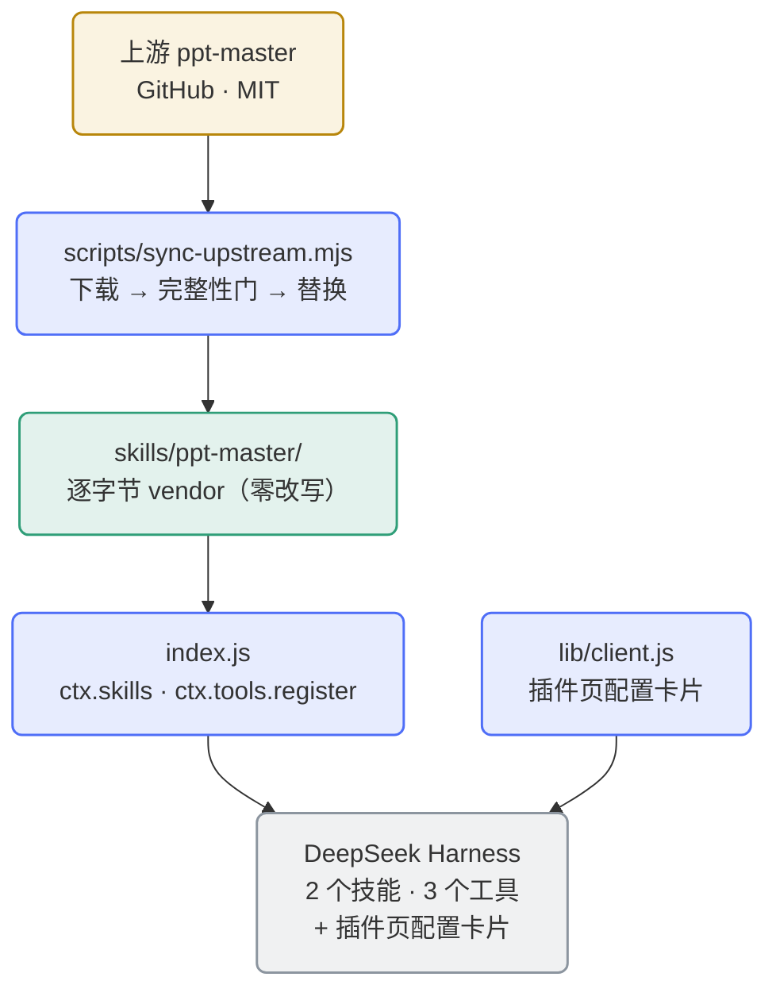

<div align="center">

[English](README.en.md) | **简体中文**

</div>

<div align="center">


</div>

# dsh-ppt-master-wrapper

**把上游 [ppt-master](https://github.com/hugohe3/ppt-master) 技能集忠实封装为 [DeepSeek Harness](https://github.com/deepseek-ai) (DSH) 插件** —— 逐字节 vendor、零改写、零运行时依赖、可一键同步上游。

上游技能集本身是一个完整的 AI 演示文稿工作流（生成 / 重构 / 美化 PPTX、Brand·Style·Layout·Deck 工作区、原生模板填充）。本包装层不做任何内容改写，只负责**把它可靠地装进 DSH**：注册技能、暴露生命周期工具、提供 venv 解释器隔离与图形化配置卡片。

- **零改写**：vendor 的 `skills/ppt-master/` 与上游 release **逐字节一致**，天然通过上游 `attribution_guard.py` 完整性门；
- **零运行时 npm 依赖**：纯 Node 内置模块实现；技能的 Python 依赖由生命周期工具按需安装；
- **可更新**：`scripts/sync-upstream.mjs` 一键同步上游新版本（下载 → 完整性门 → 校验 → 替换 → commit/tag/push）；
- **解释器可隔离**：可选 venv 模式，为上游脚本提供独立解释器，容器场景可落到持久卷；
- **配置图形化**：自带客户端半边，DSH「插件」页直接出配置卡片（中英双语），保存**免重启生效**。

## 架构



技能面由 `index.js` 经 `ctx.skills` 注册：vendor 的 `ppt-master` 技能＋一个**内存合成、不落盘**的入口技能 `ppt-master-env`（解释器路由入口）。DSH 通过 `resourceBase` 注入技能目录绝对路径，由执行 agent 代入上游约定的 `${SKILL_DIR}`——机制等价满足上游 `SKILL.md` 的硬规则。

## 安装

### 前置依赖

| 依赖 | 用途 | 备注 |
|---|---|---|
| **DeepSeek Harness** | 运行宿主 | 客户端半边（配置卡片）需 **DSH ≥ 0.2.0-rc.2**；更早版本安静降级为"无卡片"，其余功能不受影响 |
| **Node.js ≥ 20** | 插件与工具运行时 | 纯内置模块，无 npm 依赖 |
| **python3 ≥ 3.10** | 上游脚本套件与完整性门 | 建议 `python3-venv` 可用（venv 模式依赖其 ensurepip；Alpine 自带） |
| **pip3** | 安装上游 Python 依赖 | venv 模式下改用 `<venv>/bin/pip3`，不受 PEP 668 拦截 |
| **git** / **tar** | 同步脚本（ls-remote、commit、tag、push / 解压 tarball） | 仅同步上游时需要 |

### 安装到 DSH

方式一——GitHub 直接安装（推荐）：

```bash
dsh plugin --profile <name> add https://github.com/SAXEM1997/dsh-ppt-master-wrapper.git
```

方式二——本地路径 link（开发机 / 已 clone 场景）：

```bash
dsh plugin --profile <name> add link:/path/to/dsh-ppt-master-wrapper
```

方式三——内网镜像（可选，与 GitHub 同源）：将上面的 URL 换成内网 GitLab 上本仓库的地址即可（自建环境，host 从略）。

安装后重启会话，`ppt-master` 技能即对 agent 可见。当前包版本自带**客户端半边**（插件页配置卡片），宿主须**重启一次**才会首次装载它——之后保存配置即**免重启生效**（见下文「重启边界与诊断」）。

### 首次使用：环境自检、依赖与 `.env`

1. **环境自检**：调用 `ppt_master_check_env` 工具，确认 python3 就绪、完整性门通过、Python 依赖已安装。
2. **安装 Python 依赖**：调用 `ppt_master_setup_deps`（幂等执行 `pip3 install -r "${SKILL_DIR}/requirements.txt"`），或手动 `pip3 install -r skills/ppt-master/requirements.txt`。
3. **配置 `.env`（按需）**：上游图像生成脚本需要图像后端配置。首次使用时从 vendor 的模板复制一份到**工作区根目录**：

   ```bash
   cp skills/ppt-master/.env.example .env
   ```

   > 请在**你的会话工作目录**（即运行 PPT 生成的 cwd——上游 `.env` 查找顺序的第 1 位）执行该 `cp`；插件根目录下的副本也会被上游按第 3 顺位（`REPO_ROOT`）读取——打包布局下插件根恰为上游 `config.py` 的 `REPO_ROOT`；仅当工作目录无 `.env` 时才会走到该顺位。

   然后按需填写图像后端 API key：设置 `IMAGE_BACKEND`（推荐核心后端 `openai` / `gemini` / `qwen` / `zhipu` / `volcengine`）并取消注释对应提供商的 key/model 行。也可不写 `.env`，直接以进程环境变量提供同样配置。各项含义与全部可用后端见 `.env.example` 内注释。

   > `.env` 已列入 `.gitignore`，不会被提交；本插件工具不读取、不回显 `.env` 内容或任何密钥。

## 生命周期工具

插件经 `ctx.tools.register` 暴露三个工具（中英双语描述）。工作流本身（生成 / 重构 / 美化 PPT 等）由 skill 驱动，不封装为工具。

| 工具 | 参数 | 行为 |
|---|---|---|
| `ppt_master_info` | 无 | 返回插件版本、包裹的上游版本（解析 vendor `SKILL.md` 的 `metadata.version`）、`SKILL_DIR` 绝对路径（扫描 `skills/*/SKILL.md`，主目录按 `name: ppt-master` 锚定）与上游 repo 链接。纯读。 |
| `ppt_master_check_env` | 无 | 环境自检：python3 ≥ 3.10 就绪度；运行 vendor `attribution_guard.py` 并报告通过与否；解析 `requirements.txt` 顶层发行版名并以发行版元数据（`importlib.metadata`）为一等手段探测安装状态（dist→import 映射缺失的项记 UNKNOWN 而非 FAIL）；检查 `.env` 是否存在（仅提示）。输出结构化诊断，只读。 |
| `ppt_master_setup_deps` | `user?: boolean`、`breakSystemPackages?: boolean` | 幂等执行 `pip3 install -r "${SKILL_DIR}/requirements.txt"`（按参数附 `--user` / `--break-system-packages`）；完成后自动复跑环境自检并汇报。**唯一有副作用的工具**。 |

> 三个工具均为 **venv 感知**：`ppt_master_info` / `ppt_master_check_env` 的 payload 带 `venv` 小节（`enabled`（**配置值**）/`path`/`exists`/`pythonPath` 等）；`ppt_master_setup_deps` 的 payload 带 `venv` / `cleanup` 两节（其中 `enabled` 为**生效态**：配置关闭或无效行均为 `false`），且 venv 的创建/删除只发生在它。`venv.enabled=true` 时 `info`/`check_env` 的工具描述追加解释器提示语（模型未读入口技能时的兜底）。

## venv 隔离与配置卡片

插件声明原生 cordis Config（`venv.enabled` / `venv.path` / `venv.oldPathPolicy`，三叶子逐个 `.volatile()`）。本包**自带客户端半边**（`lib/client.js`，经 `package.json` 的 `dsh.client` / `exports["./client"]` 声明），在宿主「插件」页上渲染本插件的配置卡片——**这是本版的首选配置入口**。宿主侧 `dsh-settings.describe()` 仍会为带 volatile 的 profile 条目投影出 settings 命名空间；profile `cordis.patch.yml` 手工条目保留为**等价通道**（见下节），且该通道**手工编辑后不热生效、需重启 DSH**。

**懒创建**：venv 的创建/删除**只**发生在 `ppt_master_setup_deps`，改配置本身零副作用。

### 配置卡片（首选入口）

- **入口路径**：GUI 侧边栏 **插件页 → 已安装 → `dsh-ppt-master-wrapper`** → 包详情页的配置卡片。
- **卡片内容**：三字段（`venv.enabled` 开关 / `venv.path` 文本框 / `venv.oldPathPolicy` 选择器）＋版本信息块（插件版本 / 上游 ppt-master 版本 / 技能目录 `<包根>/skills/ppt-master`），文案**中英双语跟随界面语言**。
- **保存语义**：改动经宿主配置通道保存——三叶子全 volatile ⇒ 走宿主 **volatile 快路径**（只写 `fiber._config` + `_commitVolatile()` → `loader/volatile-update`，**不 remount、不重跑 `apply`**），**免重启生效**（工具行为与入口 skill 正文随 volatile 引用原地换代）。
- **memory 模式**：若宿主以 memory 模式提供配置（非回环浏览器），卡片显式提示「当前会话为 memory 模式，**本次会话不会写入宿主配置**」——写永不落盘，静默失效不可接受。
- **失败呈现**：卡片保存失败按两类呈现（宿主拒绝 / 被更高优先级配置层覆盖 vs 传输失败），"被覆盖"只在文案里给一般化提示。
- **等价性**：卡片与 profile patch 通道**二者等价、先写者为准**。

### 配置指引（profile patch——与卡片等价的通道）

编辑 profile 的 `cordis.patch.yml`，追加：

```yaml
- id: dsh-ppt-master-wrapper
  config:
    venv:
      enabled: true
      path: /dsh-home/.ppt-master/venv
      oldPathPolicy: keep
```

**三个字段写全**——patch 的 `config` 是整体替换语义（缺字段回落默认值）；**保存后须重启 DSH 生效**（这条**手工 patch 通道**无 watcher 热应用；与插件页卡片的免重启快路径不同）。

`venv.path` 须为绝对路径或 `~` 前缀（`~` 按宿主进程 HOME 展开；相对路径判无效 → venv 视为关闭 + 应用期 `console.warn`；可见反馈通道＝入口 skill「配置无效」态与 `ppt_master_check_env` 的 `venv.path=null`——渲染行逐字打印 `venv: enabled=true path=- exists=false python=skipped`）。生效核验：`ppt_master_check_env` 应打印 `venv: enabled=true path=<你的路径> …`。

> 宿主设置页 describe 输出的 `applies:"live"` 是固定输出；**手工 patch 通道**改后不热生效，别按它推断"改了就热生效"——卡片通道才是免重启的。

**默认路径理由**：`~/.ppt-master/venv` 兼顾非容器 DSH 用户的通用性，贴合上游 `~/.ppt-master/.env`（USER_ENV_FILE）目录惯例；容器用户宜显式配置到挂载卷（如 `/dsh-home/.ppt-master/venv`）。

### 入口技能用法（四态）

任何 `ppt-master` 路由前**先读 `ppt-master-env`**（内存合成、不落盘）。四态：

1. **venv 开、已建且就绪**（就绪＝解释器 `<path>/bin/python3` 与安装路径 `<path>/bin/pip3` **两者**都可用，与 `setup_deps` 的收编体检同一判据）→ 一律以解析后绝对路径的 `<path>/bin/python3` 替换上游脚本里的字面 `python3`（含 `SKILL.md` 第 2 步 `attribution_guard.py` 的调用），并给出 `SKILL_DIR`；
2. **venv 开但未建** → 先调 `ppt_master_setup_deps`，在此之前不要用系统 `python3` 跑业务脚本；
3. **venv 关** → 现行系统 `python3`；
4. **配置无效** → 按正文给出的修正方式处理后按系统模式继续。

**未就绪子态**（`on-ready` + `broken`：`bin/python3` 不可用，**或**有 `bin/python3` 但缺 `bin/pip3` 的半成品——`python3 -m venv` 在 ensurepip 阶段失败的残留）不属①：没有可用的解释器路径可替换，正文按②给「先 `setup_deps` 准备环境」的指引（`setup_deps` 会以恢复指引 fail-loud：手动删除该目录后重跑；缺 `bin/pip3` 时另提示"若系统缺 ensurepip，需先安装 `python3-venv`"）。

**三面口径一致**：同一形态下 `info` 报 `exists=true ∧ pythonPath=null`、`check_env` 渲染 `python=not found`（deps 全 UNKNOWN、guard `{skipped}`）、入口正文按②——不存在"某面说健康、另一面说未就绪"的分叉。正文是**插件实例注册期快照**：文件系统变化（如 venv 被外部删除）后可能陈旧，以 `ppt_master_info` / `ppt_master_check_env` 的实时输出为准。

### 删除安全与孤儿处理

- **标记即授权**：自动删除只对**带所有权标记**（`<venv>/.ppt-master-wrapper.json`）且同时满足四条件（路径≠当前、新旧路径互不**段感知**前缀包含、`pyvenv.cfg` 存在、带标记）的目录生效。条件①②按**规范化（canonical）路径**判定——重复分隔符、`.`/`..`、符号链接别名、以及 `..` 作用在符号链接上的拼写都按**内核语义**化到同一形态后比较：**同一实体**（canonical 相等；另以 `dev+ino` 相等作额外正判据）与**包含关系**都据此拒绝，"本次在用的 venv"及其祖先/内部目录绝不会落到删除路径上。前缀包含是**段感知**的：`/a/venv` 不包含 `/a/venv-older`（朴素 `startsWith` 会误拒，导致旧 venv 永远清不掉）。删除原语收到的仍是配置里那条路径的**原值**。
  **退化文件系统注记**：别名判定依赖 `realpath`/`st_ino` 的可靠性——`st_ino`/`st_dev` 为 0 的 FS 上 `dev+ino` 判据自动停用（否则任意两目录都会"相等"，清理被永久锁死），此时只按 canonical 路径比较；这类文件系统上可能**额外拒绝**（拒绝面只会更保守）——**限定**：「不会误删」仅对 `realpath` 可解析的别名成立，若同时存在 canonical 折不掉的别名（如 bind mount），该保护不覆盖包含面。**已标记 venv 目录内混入的用户数据会被递归删除**——不要往 venv 目录里放数据。
- **禁用后手动清理**：`venv.enabled=false` **不删除任何目录**；`oldPathPolicy=keep`（默认）时旧 venv 保留待手动清理，`delete` 也仅删「带所有权标记且满足删除四条件」的旧目录。手动清理：`rm -rf <原 venv.path>`。
- **两类孤儿（均手动处理）**：
  1. **未标记孤儿**（目录是 venv 但无标记）：清理永不触碰（安全侧默认），`info` / `check_env` 也不提示——需手动 `rm -rf`。
  2. **有标记无登记孤儿**：登记位置固定为 `<HOME>/.ppt-master/wrapper-state.json`，而 venv 常居持久卷——**层级错配**：容器场景 HOME 易失，容器重建后登记丢失，旧 venv 便成「有标记但无登记」的孤儿；无登记即无清理依据，**永不自动删**，只能手动 `rm -rf`。取舍：登记位置保持 `<HOME>` 单一、不做多位置登记。

### 挂载卷 / 镜像不变边界与 PEP 668

- **挂载卷**：挂载只保证**数据不丢**；跨容器重建后 venv 是否可用依赖**镜像不变**（venv 内符号链接指向容器内绝对路径）。**容器挂载卷建议**：把 `venv.path` 显式配置到持久卷（如 `/dsh-home/.ppt-master/venv`），不要留在容器 rootfs。
- **损坏恢复**：镜像换代、或 venv 损坏（未就绪子态）时，恢复方式＝**删除重建**：`rm -rf <venv.path>` 后重跑 `ppt_master_setup_deps`（工具不会自动删除损坏 venv，只给出该指引）；**半成品 venv（有 `bin/python3` 无 `bin/pip3`）同样＝删除重建**；若根因是系统缺 ensurepip，须先 `apt install python3-venv`，否则删了重建照样失败。
- **PEP 668**：本机系统 Python 为 PEP 668（EXTERNALLY-MANAGED）时，裸 `pip3 install` 需 `--break-system-packages`，且装入容器 rootfs、重建即丢。开启 venv 隔离后由 `<venv>/bin/pip3 install -r ...` 安装，不受 PEP 668 拦截。`user` / `breakSystemPackages` 两个参数**仅系统模式生效**，venv 模式下被忽略并在返回中注明。

## 重启边界与诊断

### 重启边界

- **保存配置不需要重启**：三叶子全 volatile ⇒ 走宿主 volatile 快路径（**不 remount、不重跑 `apply`**）。
- **只有声明面需要重启**：改 `dsh.client` 或 `exports["./client"]`（`package.json`）需重启宿主才重新装载客户端半边；仅改 `lib/client.js` 本体**免重启**（宿主 stat 轮询热更新，约 500ms）。
- **profile `cordis.patch.yml` 的手工编辑走另一条通道**：不**走 volatile 快路径、无 watcher 热应用，**需重启 DSH** 生效。

### 配置卡片诊断（卡片不出现 / 不可用时的分层排查）

本包自带客户端半边（注册 `plugins.bundle.config` 卡片，键＝包名），故**本版 DSH 应能出配置卡片**。若卡片没出现或显示不可用，按**四层**依次排查：

1. **声明面是否已生效**：`dsh.client` / `exports["./client"]` 属**装载期**声明——刚改过 `package.json` 需**重启 DSH** 才重新装载客户端半边（仅改 `lib/client.js` 免重启，stat 轮询热更新）。这是最常见的"改了没反应"。
2. **宿主页是否在场**：卡片由插件页渲染，槽位名 `plugins.bundle.config`；若宿主页 `dsh-client-ui-plugin-manager` 缺席或未提供该槽位，则**槽位无人声明 ⇒ 卡片不出现**（与"半边未装载"不同，且宿主对 `dsh.client.inject` 图内不存在的包**静默跳过**、不报 warn——`inject` 只用于装载排序，不是 Cordis 服务注入）。
3. **`configForms` 服务是否可用**：该服务经 `ctx.inject(['configForms'], cb)` **可选**接入（**不在**硬 `inject` 里）。服务缺失 ⇒ 回调不触发、该接入不注册，但槽位注册照常 ⇒ 卡片显示「**配置通道未接入**：宿主未提供 `configForms` 服务」（快照恒 `undefined`；命名空间未暴露时另显「配置通道**不可用**」态，两者文案不混用）。
4. **老宿主不认 `dsh.client`**：该字段为**惰性元数据**，宿主半边照常工作、浏览器不加载任何东西 ⇒ **安静降级，插件功能不受影响**（只是没有卡片）；此时配置仍可走 profile patch 通道，或升级宿主。**宿主下限**：客户端半边依赖 DSH 0.2.0-rc.2 的契约（`dsh.engines.dsh` 仍写 `>=0.1.1-rc.1`，故老宿主不会因引擎门被拒装，而是走本条静默降级）。

**另有硬失败形态（非安静降级）**：硬服务 `slots` / `locale` 缺失时 `apply` **不被调用**，宿主以 `pending (waiting for service…)` 上报；同理若 `dsh.client.external` 未声明 `react`，`require` 命中不了模块表并**冒泡出页**。单个注册点异常（字典 / 槽位 / 订阅）则各自 try/catch → warn，**不影响其余注册点**。

### 其他诊断

- **schemastery 解析失败**：插件装载期经「宿主 node_modules 定位 + `createRequire` 受控解析」取 `@deepseek-ai/schemastery`（**禁 ESM 裸导入**）；解析失败＝模块加载期 fail-loud，**整插件不可加载、vendor 技能面连带丢失**。诊断：确认宿主 profile 的 `node_modules` 内存在该包，且 `DSH_NODE_MODULES` / `DSH_PROFILE_DIR` / `DSH_HOME(+DSH_PROFILE)` 指向它。
- **入口技能缺失**：宿主注册面若拒绝**不带 `resourceBase`** 的合成候选，则入口技能缺失，而 **vendor 技能不受影响**（入口不落盘、不进字节比对面）；该字段已被宿主源码实证为条件透传的可选字段，接受性由 `node scripts/check-dsh-compat.mjs` 的 §7.7⑤ 实跑复核。
- **配置无效行的措辞**：`enabled=true` + 非法路径时工具描述仍按**配置开关**显示 venv 提示语，实际行为按系统模式降级——以 `venv.path=null`（渲染行 `venv: enabled=true path=- exists=false python=skipped`）与入口 skill 第四态为准。

### profile 层条目与升级补全

- **bundle insert 层**：本包自带 `cordis.patch.yml`（`insert:` 段内 `id: dsh-ppt-master-wrapper`），随插件安装生效——由 `check-dsh-compat` 静态断言。
- **profile 层条目**：可由**操作者手工建立**（上文 YAML；bundle 层的 `insert:` 只声明条目 id，不承载 config）。若宿主无该 id 条目，则经**插件页卡片**（或宿主 config-editor 通道）首次编辑并保存任一 venv 字段时，由宿主代建同形条目（`index<0` → `add({id,name,config})`）——两通道等价，先写者为准。bundle 层静态存在**不替代** profile 层条目。
- **升级补全（config 整体替换语义）**：profile patch 内的 config 是**整体替换**而非深合并——插件升级新增字段后，已存在的 patch 条目须与新字段集比对补全，否则新字段回落默认值（例如升级后旧条目不会自动长出 `enabled`）。升级后可在**插件页卡片**上重新保存一次，或**手工比对补全**缺失字段。

### 兼容面负向确认

合成入口 skill `ppt-master-env` **不落盘**（内存合成），不进入 vendor `skills/` 树——`scripts/verify-plugin.mjs` 的字节比对面因此**零变化**（负向确认）。`scripts/sync-upstream.mjs` 不读取本插件产物，本特性零脚本交互面。

## 同步上游更新

```bash
node scripts/sync-upstream.mjs [选项]
```

| 选项 | 语义 |
|---|---|
| `--ref <tag\|branch\|commit>` | 指定上游 ref（默认：最新语义版本 release tag） |
| `--repo <url>` | 上游仓库 URL（默认 `https://github.com/hugohe3/ppt-master.git`；ls-remote 与 tarball 下载同源取值） |
| `--refresh` | 强制忽略 `.upstream/` 缓存重新下载 |
| `--confirm-structural` | 结构变化已人工确认，强制走自动路径（重跑固定上次检出的 ref） |
| `--skip-guard` | 跳过 `attribution_guard.py` 的执行（须与 `--no-push` 或 `--dry-run` 联用；verify-plugin 的 JS 等价校验仍会拦截，不构成完整性放行） |
| `--no-push` | 只本地 commit + tag，不推送 |
| `--dry-run` | 只输出将发生的变化，不替换/commit/tag/push |

流程：解析最新 release tag → 下载（或复用 `.upstream/` 缓存）→ staging → 完整性门（逐 skill 运行 guard）→ 结构变化检测 → 无结构变化（或已确认）时自动路径：verify-plugin 前置于替换 → 以 staging 替换 `skills/` → bump `package.json` version → 单次 commit + tag `v<version>` → push。

**结构变化 🔴**（skill 目录增删、skill 重命名、`metadata.version` 缺失等）时停下报告（退出码 2，写入仓库根 `sync-report.txt`）：人工评估并按需更新包装层后，以 `--confirm-structural` 重跑完成同步。

**推送凭据**：设置环境变量 `DSH_PPT_GITLAB_PAT`（自建 GitLab 镜像）或改用 `git` credential helper；缺失时推送环节以退出码 `6` 失败并在报告中输出配置指引。

**版本策略**：`package.json` version 镜像上游版本（如 `6.7.1`）；仅包装层自身变更或同版本重同步时追加 `-rN` 后缀。

退出码速查：`0` 成功/已是最新；`1` 用法错误；`2` 结构变化待人工；`3` 完整性门失败；`4` verify-plugin 校验失败（vendor 树未触碰）；`5` 网络/来源失败；`6` 推送失败/tag 冲突；`7` 工具链缺失（python3/git/tar 不可用，或无法运行 guard 脚本）。

## 目录结构

```
dsh-ppt-master-wrapper/
├── package.json                  # DSH 插件清单（dsh.client / dsh.bundle.patch / exports）
├── cordis.patch.yml              # DSH bundle 层补丁（insert 条目）
├── index.js                      # 插件入口：ctx.skills 注册 + ctx.tools.register × 3
├── lib/
│   ├── client.js                 # 客户端半边：插件页配置卡片（自包含单文件）
│   ├── tools.js                  # 三个生命周期工具
│   ├── venv.js                   # venv 解析 / 就绪判定 / 安全删除
│   └── skill-provider.js         # vendor 技能面 + 合成入口 ppt-master-env
├── skills/ppt-master/            # ★ 上游 vendor 树（逐字节，零改写）
├── scripts/
│   ├── sync-upstream.mjs         # 上游同步（下载/门禁/替换/commit/tag/push）
│   ├── verify-plugin.mjs         # 完整性 + provider/工具面校验
│   └── check-dsh-compat.mjs      # 对照已装 DSH SDK 的契约检查
├── tests/                        # node:test 全套（570+ 用例）
├── static/logo.svg               # 首页图
├── docs/superpowers/             # 本项目的设计与计划（开发史）
├── README.md / README.en.md
├── NOTICE
└── LICENSE
```

## 本地校验（开发）

```bash
# 完整性+provider/工具面校验（--root 缺省即包内 skills/；--upstream 必须显式传，
# 取 .upstream/ 缓存目录名 <ref>@<sha>）
node scripts/verify-plugin.mjs --upstream .upstream/refs/tags/v6.7.1@aabf2a0541d9d3b0bdb9e8564a0217f0eaff7815

# 对照已安装 DSH SDK 的契约检查（真实 SkillRegistry 挂载 + tools.register + rank
# + spec §7.7 六项设计成立性前置检查：Config volatile / apply 第二参 / bundle insert
#   层 / schemastery 受控解析通道 / 生产根形态读回入口技能 / 客户端半边 stub 装载与注册）
node scripts/check-dsh-compat.mjs

# 全套测试
node --test tests/*.test.mjs
```

> **环境前置（schemastery 受控解析通道）**：`tests/apply.test.mjs`、`tests/verify-plugin.test.mjs`
> 与 `scripts/verify-plugin.mjs` 都**静态 import `../index.js`**，而入口在**模块加载期**即经
> 「宿主 node_modules 定位 + `createRequire` 受控解析」取 `@deepseek-ai/schemastery`。干净机器上
> 该包解析不到时，这三个文件在 import 期**整体失败**（不是某条用例失败）——需让它经
> `DSH_NODE_MODULES` / `DSH_PROFILE_DIR` / `DSH_HOME`(+`DSH_PROFILE`) 或宿主 profile 的
> `node_modules` 可解析（同上面「schemastery 解析失败」）。
>
> **同一条前置也覆盖 `tests/compat.test.mjs`，机制不同、红灯形态也不同（实测签名）**：该文件不
> 静态 import 插件入口，但其中 13 处 in-process `runCompatCheck({ … env: {} })` 走的是脚本内**真实**的
> 动态 `import(PLUGIN_ENTRY)`，而 `options.env` 只喂 SDK 定位级、封不住插件侧对 `process.env` 的读取。
> 因此该文件整体依赖宿主 `@deepseek-ai/schemastery` 可解析（in-process 真装载）：洁净环境下
> **36 例中 7 红 29 绿**（13 处 in-process 里 7 红 6 绿），**不是**整批转红。可辨识的红灯形态是
> `schemastery 定位失败` 那一串：`apply(ctx, { skillRoots }) 驱动 …index.js 失败: @deepseek-ai/schemastery
> 未能解析: 定位链四级均未命中`；其余 29 例（含全部 CLI 子进程用例，它们自带 stub 树注入
> `DSH_NODE_MODULES=<stub 树>/node_modules` 与 `{env:{}}` 失败态分组）不受此限，照常绿。

## 版本历史

| 版本（tag） | 说明 |
|------|------|
| `v6.7.0` | 首次交付：vendor 上游 v6.7.0（78MB 逐字节）+ skill provider + 三生命周期工具 + verify/compat/sync 三脚本 |
| `v6.7.0-r1` | 包装层修订（规则③自动 bump 首跑）：Gate 3 审查修复——`mapDistToImport` 原型键防护、branch-ref last-sync 可读性、`envFileExists` 三处探测、spec §4.3 规则③执行主体修订（自动语义） |
| `v6.7.0-r2` | 包装层修订（规则③）：UltraReview 独立复审两轮修复——规则③自触发锚定排除、push 部分失败 tag 补推（鉴权预判）、branch sha 缓存、git/tar 工具链缺失归 7、marketplace 版本校验层级修正、`env` 第 4 探测位置（`~/.ppt-master/.env`）、依赖映射 19/19、`${SKILL_DIR}` 独立判据、`.gitignore` 卫生条目、dry-run 状态写门控、文档四处机制补记 |
| `v6.7.0-r3` | 包装层修订：**venv 解释器隔离**（`venv.enabled` / `venv.path` / `venv.oldPathPolicy` + 入口技能 `ppt-master-env` + 安全删除四条件）+ **插件页配置卡片**（客户端半边，中英双语、版本信息块、volatile 快路径免重启保存）+ 配置卡片外观对齐宿主设计语汇；本次同时补齐 GitHub 发布面（双语 README / NOTICE / logo / 包元数据） |
| `v6.7.1` | 上游同步（规则①：上游版本变化 ⇒ base 6.7.1、`-r` 归零）：vendor 上游 v6.7.1（逐字节，完整性门通过）；包装层此前 3 次修订（r1–r3）针对的是 6.7.0 base |

> 版本规则：`base` 镜像上游 release；包装层修订追加 `-rN`（无后缀视为 r0）。

## 致谢与许可

- 上游项目：[hugohe3/ppt-master](https://github.com/hugohe3/ppt-master)（MIT，© 2025-2026 Hugo He）——本包装层的全部能力来自上游技能集，感谢作者的杰出工作。
- **双 LICENSE 归属**：插件根 [`LICENSE`](LICENSE) 为本项目 `dsh-ppt-master-wrapper` 自身的 MIT 许可；vendor `skills/ppt-master/LICENSE` 为**上游原文，逐字节保留**（受上游 `attribution_guard.py` 完整性门校验，不得改动）。两者独立共存，完整上游版权声明见 [`NOTICE`](NOTICE)。
- vendor 内的 `SPONSORS.md` / `SPONSORS_CN.md` 等归属文件同样逐字节保留，欢迎按上游指引赞助原作者。

MIT，见 [LICENSE](LICENSE)。
