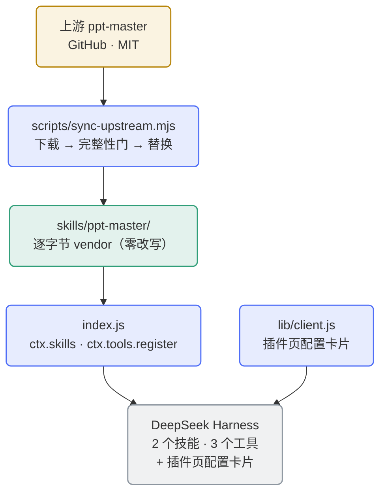

<div align="center">

[English](README.en.md) | **简体中文**

</div>

<div align="center">


</div>

# dsh-ppt-master-wrapper

**把上游 [ppt-master](https://github.com/hugohe3/ppt-master) 技能集忠实封装为 [DeepSeek Harness](https://github.com/deepseek-ai) (DSH) 插件** —— 逐字节 vendor、零改写、零运行时依赖、可一键同步上游。

上游技能集本身是一个完整的 AI 演示文稿工作流（生成 / 重构 / 美化 PPTX、Brand·Style·Layout·Deck 工作区、原生模板填充）。本包装层不做任何内容改写，只负责**把它可靠地装进 DSH**：注册技能、暴露生命周期工具、提供 venv 解释器隔离、图形化配置卡片与工具可见范围控制。

- **零改写**：vendor 的 `skills/ppt-master/` 与上游 release **逐字节一致**，天然通过上游 `attribution_guard.py` 完整性门；
- **零运行时 npm 依赖**：纯 Node 内置模块实现；技能的 Python 依赖由生命周期工具按需安装；
- **可更新**：`scripts/sync-upstream.mjs` 一键同步上游新版本（下载 → 完整性门 → 校验 → 替换 → commit/tag/push）；
- **解释器可隔离**：可选 venv 模式，为上游脚本提供独立解释器，容器场景可落到持久卷；
- **配置图形化**：自带客户端半边，DSH「插件」页直接出配置卡片（中英双语），保存**免重启生效**。

## 架构



技能面由 `index.js` 经 `ctx.skills` 注册：vendor 的 `ppt-master` 技能＋一个**内存合成、不落盘**的入口技能 `ppt-master-env`（解释器路由入口）。DSH 通过 `resourceBase` 注入技能目录绝对路径，由执行 agent 代入上游约定的 `${SKILL_DIR}`——机制等价满足上游 `SKILL.md` 的硬规则。

## 安装

### 前置依赖

| 依赖 | 用途 | 备注 |
|---|---|---|
| **DeepSeek Harness** | 运行宿主 | 配置卡片需 **DSH ≥ 0.2.0-rc.2**；更早版本安静降级为"无卡片"，其余功能不受影响 |
| **Node.js ≥ 20** | 插件与工具运行时 | 纯内置模块，无 npm 依赖 |
| **python3 ≥ 3.10** | 上游脚本套件与完整性门 | 建议 `python3-venv` 可用（venv 模式依赖其 ensurepip） |
| **pip3** | 安装上游 Python 依赖 | venv 模式下改用 `<venv>/bin/pip3`，不受 PEP 668 拦截 |
| **git** / **tar** | 同步脚本 | 仅同步上游时需要 |

### 安装到 DSH

```bash
# 方式一：GitHub 直接安装（推荐）
dsh plugin --profile <name> add https://github.com/SAXEM1997/dsh-ppt-master-wrapper.git

# 方式二：本地路径 link（开发机）
dsh plugin --profile <name> add link:/path/to/dsh-ppt-master-wrapper
```

方式三——内网镜像（可选，与 GitHub 同源）：把上面的 URL 换成内网 GitLab 上本仓库的地址即可。安装后重启会话，`ppt-master` 技能即对 agent 可见；客户端半边（配置卡片）须宿主**重启一次**才首次装载——之后保存配置即**免重启生效**。

### 首次使用

1. **环境自检**：调用 `ppt_master_check_env`，确认 python3 就绪、完整性门通过、Python 依赖已安装。
2. **安装 Python 依赖**：调用 `ppt_master_setup_deps`（幂等），或手动 `pip3 install -r skills/ppt-master/requirements.txt`。
3. **配置 `.env`（按需）**：上游图像生成脚本需要图像后端配置。在**会话工作目录**（上游 `.env` 查找顺序第 1 位；插件根目录为第 3 顺位兜底）执行
   `cp skills/ppt-master/.env.example .env`，按文件内注释填写 `IMAGE_BACKEND` 与对应 key/model
   （也可用进程环境变量提供同样配置）。`.env` 已列入 `.gitignore`；插件工具不读取、不回显其内容。

## 生命周期工具

| 工具 | 参数 | 行为 |
|---|---|---|
| `ppt_master_info` | 无 | 插件版本、上游版本、`SKILL_DIR` 绝对路径与上游 repo 链接。纯读。 |
| `ppt_master_check_env` | 无 | 环境自检：python3 就绪度；运行 `attribution_guard.py`；探测 Python 依赖安装状态；提示 `.env` 是否存在。只读。 |
| `ppt_master_setup_deps` | `user?`、`breakSystemPackages?` | 幂等安装 `requirements.txt`，完成后自动复跑自检。**唯一有副作用的工具**；venv 的创建/删除只发生在它。 |

三个工具均 **venv 感知**（payload 带 `venv` 小节；`venv.enabled=true` 时工具描述追加解释器提示）。`user` / `breakSystemPackages` **仅系统模式生效**，venv 模式下被忽略并在返回中注明。

## 配置

插件声明原生 cordis Config，两组键、全部叶子 `.volatile()`——经**插件页卡片**保存后走宿主 volatile 快路径，**免重启生效**；经 profile `cordis.patch.yml` 手工编辑则**需重启 DSH**。两通道等价、先写者为准。

### 插件页卡片（首选入口）

GUI 侧边栏 **插件页 → 已安装 → `dsh-ppt-master-wrapper`** → 包详情页配置卡片：venv 三字段（`enabled` / `path` / `oldPathPolicy`）＋「工具可见范围」一节＋版本信息块，文案中英双语跟随界面语言。memory 模式会话中卡片显式提示"本次不会写入宿主配置"。

### venv 隔离

| 键 | 取值 | 默认 |
|---|---|---|
| `venv.enabled` | 是否启用 venv 解释器隔离 | `false` |
| `venv.path` | venv 目录（绝对路径或 `~` 前缀；相对路径判无效） | `~/.ppt-master/venv` |
| `venv.oldPathPolicy` | 改路径后旧 venv 处置：`keep` / `delete` | `keep` |

- **懒创建**：改配置零副作用；创建/删除只发生在 `ppt_master_setup_deps`。
- **容器建议**：把 `venv.path` 显式配置到持久卷（如 `/dsh-home/.ppt-master/venv`）——venv 内符号链接指向容器内绝对路径，跨镜像重建是否可用依赖镜像不变。
- **损坏恢复**：删除重建（`rm -rf <venv.path>` 后重跑 `setup_deps`）；半成品（缺 `bin/pip3`）同样删除重建，系统缺 ensurepip 时先装 `python3-venv`。
- **删除安全**：自动删除只碰**带所有权标记**且满足安全条件的旧 venv；`enabled=false` 不删除任何东西；**不要往 venv 目录里放用户数据**。两类孤儿目录（无标记 / 有标记无登记）均需手动 `rm -rf`。
- 完整判定条件与实现细节见 [AGENTS.md](AGENTS.md) §6。

### 工具可见范围（全局 / 指定工作区）

3 个 `ppt_master_*` 工具默认注册为**全局工具**。工作区很多且多数与 PPT 无关时，可把它们从无关工作区的工具表里**真正移除**（宿主装配层 `tools.restrict`，不是前端过滤）：

| 键 | 取值 | 默认 |
|---|---|---|
| `scope.mode` | `global`（所有工作区可见） / `selected`（仅名单内可见） | `global` |
| `scope.workspaceIds` | 工作区 id 字符串数组 | `[]` |

`selected` 下：会话按「工作区 `sessionIds` 成员 → 会话 `cwd` 规范路径」两级判定归属，命中且 id 在名单里才可见——**不属于任何工作区的会话也看不到**。降级口径（明示收窄意图，答不出来时不静默放宽）：缺判定服务时按最严口径拒绝并 `console.warn`；注册表瞬时读失败维持上一轮判定；宿主缺 `tools.restrict` 时退化为仅执行层拒绝。配置走卡片的模式单选 + 工作区勾选列表（清单来自宿主 `workspaces` 服务），保存即生效。

宿主下限：`scope.mode=selected` 除配置卡片外，还依赖宿主注入 `agents` / `workspaceRegistry` 服务与 `tools.restrict` / `tools.guard` 能力；缺任一时按上述降级口径拒绝或降级（不静默放宽），不影响 `global` 模式与其余功能。

已知限制：只收窄**工具**不收窄技能条目；判定基于会话创建时的 `cwd`；已删除工作区的 id 被忽略；释放限制层时宿主抛错则该层可能残留（重启可清）；市场截图 `assets/screenshot-1-config-card.png` 待重制（卡片新增了可见范围节）。

### profile patch（等价通道）

编辑 profile 的 `cordis.patch.yml` 追加（**字段写全**——patch 的 `config` 是整体替换语义；**保存后须重启 DSH**）：

```yaml
- id: dsh-ppt-master-wrapper
  config:
    venv:
      enabled: true
      path: /dsh-home/.ppt-master/venv
      oldPathPolicy: keep
    scope:
      mode: selected
      workspaceIds:
        - b6ef89f7-74a6-4e4f-84eb-07581e390020
```

插件升级新增配置字段后，已存在的 patch 条目需比对补全（或直接在卡片上重新保存一次），否则新字段回落默认值。

## 重启边界与诊断

**哪些改动需要重启**：

- 卡片保存配置——**不需要**（volatile 快路径）；
- 只改 `lib/client.js`——**不需要**（宿主 stat 轮询热更新，约 500ms）；
- 改 `package.json` 的 `dsh.client` / `exports["./client"]` 声明面、或手工编辑 profile patch——**需要**。

**卡片没出现 / 不可用**，按序排查：① 刚改过 `package.json` 声明面？→ 重启 DSH（最常见）；② 宿主「插件」页是否提供 `plugins.bundle.config` 槽位；③ 卡片显示「配置通道未接入」＝宿主缺 `configForms` 服务（可选拼装，功能面不受影响）；④ 老宿主不认 `dsh.client` → 安静降级，插件功能不受影响，配置走 profile patch 或升级宿主。

**其他**：插件装载失败并连带技能面消失，通常是 `@deepseek-ai/schemastery` 受控解析失败——确认宿主 profile 的 `node_modules` 内有该包，且 `DSH_NODE_MODULES` / `DSH_PROFILE_DIR` / `DSH_HOME` 指向它（详见 [AGENTS.md](AGENTS.md) §3）。**入口技能缺失**：宿主拒绝不带 `resourceBase` 的合成候选时仅入口技能缺席，vendor 技能与工具不受影响。

## 同步上游更新

```bash
node scripts/sync-upstream.mjs [选项]
```

| 选项 | 语义 |
|---|---|
| `--ref <tag\|branch\|commit>` | 指定上游 ref（默认：最新语义版本 release tag） |
| `--repo <url>` | 上游仓库 URL（默认 `https://github.com/hugohe3/ppt-master.git`） |
| `--refresh` | 忽略 `.upstream/` 缓存重新下载 |
| `--confirm-structural` | 结构变化已人工确认，强制走自动路径 |
| `--skip-guard` | 跳过 `attribution_guard.py` 执行（须与 `--no-push` 或 `--dry-run` 联用） |
| `--no-push` | 只本地 commit + tag，不推送 |
| `--dry-run` | 只输出将发生的变化 |

流程：解析最新 tag → 下载（或缓存）→ 完整性门 → 结构变化检测 → 自动路径：校验前置于替换 → 替换 `skills/` → bump 版本（自动联动改写 `lib/client.js` 版本常量）→ commit + tag `v<version>` → push。**结构变化 🔴**（skill 目录增删、重命名、`metadata.version` 缺失等）时停下报告（退出码 2，报告写仓库根 `sync-report.txt`），人工评估后以 `--confirm-structural` 重跑。

**推送凭据**：设 `DSH_PPT_GITLAB_PAT`（GitLab 镜像）或配置 git credential helper；缺失时推送环节以退出码 6 失败并给出指引。

**版本策略**：`package.json` version 镜像上游版本（如 `6.7.1`）；仅包装层自身变更追加 `-rN` 后缀。

退出码：`0` 成功/最新 · `1` 用法 · `2` 结构变化待人工 · `3` 完整性门失败 · `4` 校验失败 · `5` 网络/来源失败 · `6` 推送失败/tag 冲突 · `7` 工具链缺失。

## 目录结构

```
dsh-ppt-master-wrapper/
├── package.json / cordis.patch.yml   # DSH 插件清单与 bundle 层补丁
├── index.js                          # 插件入口
├── lib/                              # 客户端半边 / 工具 / venv / skill provider / scope
├── skills/ppt-master/                # ★ 上游 vendor 树（逐字节，零改写）
├── scripts/                          # sync-upstream / verify-plugin / check-dsh-compat
├── tests/                            # node:test 全套（710 用例）
├── docs/superpowers/                 # 设计与计划文档（开发史）
├── .github/                          # CI 与 issue/PR 模板
└── README / AGENTS.md / CONTRIBUTING.md / NOTICE / LICENSE
```

## 开发流程（GitHub Flow）

`main` 受保护，**不直接推送**。每次改动走 **Issue → 分支 → PR → Squash merge**；提交信息用约定式前缀。细节见 [CONTRIBUTING.md](CONTRIBUTING.md)；面向 agent 的机制备忘、测试地图与版本记账见 [AGENTS.md](AGENTS.md)。

## 本地校验（开发）

```bash
node scripts/check-dsh-compat.mjs     # 契约检查：spec §7.7 六项（+⑦）设计成立性前置
node --test tests/*.test.mjs          # 全套测试（本机真实 SDK 环境 710/710）
node scripts/verify-plugin.mjs --upstream .upstream/refs/tags/<ref>@<sha>   # 完整性校验（需缓存目录）
```

无宿主 SDK 的机器（含 CI）：`node tests/helpers/stub-sdk.mjs .ci-stub` 建默认 stub 树，以 `DSH_NODE_MODULES=$PWD/.ci-stub/node_modules` 跑前两条（预期 710/708/2 skip，skip 为显式声明）；机制与红灯形态见 [AGENTS.md](AGENTS.md) §4，CI 见 `.github/workflows/ci.yml`。

## 版本历史

| 版本（tag） | 说明 |
|------|------|
| `v6.7.0` | 首次交付：vendor 上游 v6.7.0 + skill provider + 三生命周期工具 + 三脚本 |
| `v6.7.0-r1` … `r2` | 包装层修订（审查修复波：同步脚本健壮性） |
| `v6.7.0-r3` | venv 解释器隔离 + 插件页配置卡片 + GitHub 发布面 |
| `v6.7.1` | 上游同步：vendor v6.7.1（逐字节） |
| `v6.7.1-r1` | 工具可见范围（scope 双键 + 装配层移除 + guard 兜底） |

> 版本规则：`base` 镜像上游 release，包装层修订追加 `-rN`。逐项明细见 [AGENTS.md](AGENTS.md) §5。

## 致谢与许可

- 上游项目：[hugohe3/ppt-master](https://github.com/hugohe3/ppt-master)（MIT，© 2025-2026 Hugo He）——本包装层的全部能力来自上游技能集，感谢作者的杰出工作。
- **双 LICENSE 归属**：插件根 [`LICENSE`](LICENSE) 为本项目自身的 MIT 许可；vendor `skills/ppt-master/LICENSE` 为**上游原文，逐字节保留**（受完整性门校验，不得改动）。完整上游版权声明见 [`NOTICE`](NOTICE)；vendor 内 `SPONSORS*.md` 同样逐字节保留，欢迎按上游指引赞助原作者。

MIT，见 [LICENSE](LICENSE)。
